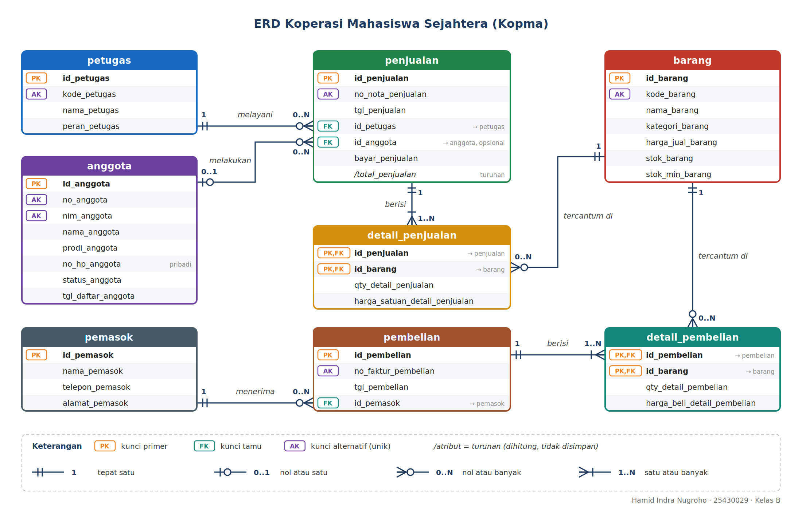
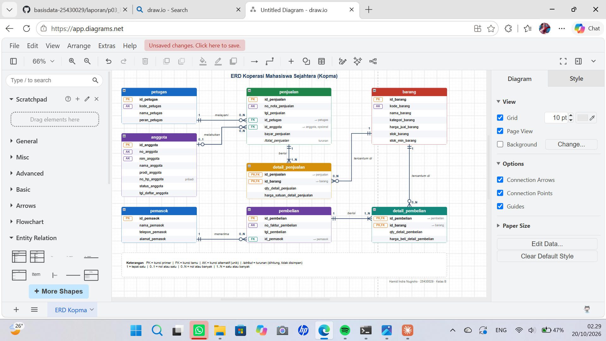
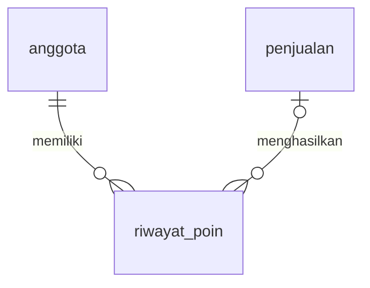
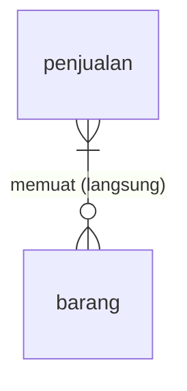

# Laporan Praktikum Basis Data - Pertemuan 03
**Nama:** Hamid Indra Nugroho  **NIM:** 25430029  **Kelas:** B  **Tanggal:** 17 Oktober 2026

**Dosen Pengampu:** Dedi Irawan, S.Kom., M.T.I.
**Topik:** Pemodelan Data dengan Entity-Relationship Diagram (ERD)

---

## 1. Tujuan Praktikum

Setelah menyelesaikan modul ini, saya diharapkan mampu:

1. Mengidentifikasi entitas, atribut, dan kunci dari dokumen kebutuhan data.
2. Menentukan relasi beserta kardinalitas dan partisipasinya dengan alasan dari aturan bisnis.
3. Memecah relasi banyak-ke-banyak menjadi entitas asosiatif.
4. Menggambar ERD notasi Crow's Foot dan memvalidasinya terhadap kebutuhan informasi (KI).

Konteksnya, dokumen kebutuhan data dari Pertemuan 2 sudah disetujui ketua Kopma, tetapi ketua kesulitan membaca tabel yang panjang. Karena itu kebutuhan tersebut saya ubah menjadi satu gambar ERD supaya hubungan antar data bisa dibaca bersama.

## 2. Ringkasan Dasar Teori

**Unsur ERD.** ERD menggambarkan data sebagai *entitas* (hal yang dicatat), *atribut* (sifat entitas), dan *relasi* (hubungan antarentitas). ERD termasuk tahap desain konseptual, jadi di tahap ini belum ada tipe data maupun pilihan DBMS. Yang dipastikan hanyalah semua kebutuhan data sudah tercakup.

| Unsur | Arti | Contoh di Kopma |
|---|---|---|
| Entitas | Benda atau kejadian yang datanya disimpan | `anggota`, `barang`, `penjualan` |
| Atribut kunci | Atribut yang membedakan setiap baris entitas | `id_anggota`; kunci alternatifnya `nim_anggota` |
| Atribut turunan | Atribut yang nilainya dihitung dari atribut lain | `total_penjualan` = jumlah (qty x harga satuan) |
| Relasi | Hubungan bermakna antarentitas, dibaca sebagai kata kerja | petugas **melayani** penjualan |
| Entitas asosiatif | Pengganti relasi banyak-ke-banyak yang punya atribut sendiri | `detail_penjualan` |

**Kardinalitas dan partisipasi.** Kardinalitas menjawab "berapa banyak paling banyak", sedangkan partisipasi menjawab "wajib atau boleh tidak ada". Pada notasi Crow's Foot keduanya digabung di ujung garis. Simbol yang dekat dengan kotak entitas menyatakan maksimum, simbol yang lebih jauh menyatakan minimum. Lingkaran (o) berarti nol atau opsional, garis tegak (|) berarti satu, dan kaki gagak (<) berarti banyak.

**Relasi banyak-ke-banyak.** Satu nota berisi banyak barang, dan satu barang muncul di banyak nota. Relasi seperti ini tidak bisa disimpan langsung di tabel relasional, apalagi relasinya punya atribut sendiri (qty dan harga saat transaksi). Solusinya adalah entitas asosiatif, yaitu `detail_penjualan`, yang berhubungan satu-ke-banyak dengan kedua entitas asalnya.

## 3. Hasil Langkah Percobaan

### 3.1 Dari entitas kandidat ke entitas (langkah D.1)

Saya mulai dari tabel entitas kandidat Kopma di dokumen Pertemuan 2, lalu menandai kunci primer, kunci alternatif, dan atribut turunan. Entitas "Pembelian dan detailnya" saya pecah menjadi `pembelian` dan `detail_pembelian` dengan pola yang sama seperti penjualan.

| Entitas | Kunci primer | Kunci alternatif | Atribut turunan |
|---|---|---|---|
| `anggota` | `id_anggota` | `nim_anggota` | - |
| `petugas` | `id_petugas` | - | - |
| `barang` | `id_barang` | `kode_barang` | - |
| `pemasok` | `id_pemasok` | - | - |
| `penjualan` | `id_penjualan` | `no_nota_penjualan` | `total_penjualan` |
| `detail_penjualan` | (`id_penjualan`, `id_barang`) | - | - |
| `pembelian` | `id_pembelian` | `no_faktur_pembelian` | - |
| `detail_pembelian` | (`id_pembelian`, `id_barang`) | - | - |

> Catatan: daftar atribut non-kunci mengikuti kamus data Pertemuan 2. Lihat gambar ERD di bagian 3.3 untuk daftar lengkapnya.

### 3.2 Relasi dan kardinalitas (langkah D.2)

Untuk setiap pasangan entitas yang berhubungan, saya menulis kalimat relasi dengan kata kerja, lalu menjawab dua pertanyaan: "minimal berapa?" dan "maksimal berapa?".

**Tabel 3.2 Relasi dan kardinalitas Kopma**

| Relasi | Sisi kiri | Sisi kanan | Dasar |
|---|---|---|---|
| petugas melayani penjualan | tepat satu petugas | nol atau banyak penjualan | wawancara kasir |
| anggota melakukan penjualan | nol atau satu anggota | nol atau banyak penjualan | AB-02 |
| penjualan berisi detail_penjualan | tepat satu penjualan | satu atau banyak detail | AB-01 |
| barang tercantum di detail_penjualan | tepat satu barang | nol atau banyak detail | AB-04 |
| pemasok menerima pembelian | tepat satu pemasok | nol atau banyak pembelian | AB-06 |
| pembelian berisi detail_pembelian | tepat satu pembelian | satu atau banyak detail | faktur pemasok |
| barang tercantum di detail_pembelian | tepat satu barang | nol atau banyak detail | pola sama dengan AB-04 |

Baris terakhir tidak ada di contoh tabel modul. Saya menambahkannya karena `detail_pembelian` juga mencatat barang, sehingga harus terhubung ke `barang` dengan pola yang sama seperti `detail_penjualan`.

### 3.3 Gambar ERD (langkah D.3)

ERD digambar di draw.io dengan pustaka bentuk *Entity Relation*. Berkas yang dihasilkan: `p03_erd_kopma_25430029.drawio` (sumber) dan `p03_erd_kopma_25430029.png` (gambar).

*Gambar 3.1 ERD konseptual Kopma dengan notasi Crow's Foot. Setiap entitas diberi warna sendiri dan ditata ringkas dalam tiga kolom: entitas master di kiri, transaksi di tengah, barang dan detail pembelian di kanan.*

Pemeriksaan terhadap standar kelengkapan ERD (Tabel 3.3):

| Unsur | Ketentuan | Status |
|---|---|---|
| Entitas | Nama huruf kecil tunggal, satu warna per entitas | Terpenuhi |
| Atribut | Semua atribut dari kamus data tercantum | Terpenuhi |
| Kunci | Label PK, FK, dan PK, FK untuk kunci primer komposit | Terpenuhi (ditambah AK untuk kunci alternatif) |
| Kardinalitas | Simbol Crow's Foot dan label angka (1, 0..1, 0..N, 1..N) | Terpenuhi |
| Garis relasi | Ditarik dari kunci primer ke kunci tamu, tidak saling menumpuk | Terpenuhi |
| Keterangan | Kotak legenda di bagian bawah diagram | Terpenuhi |

Atribut turunan `total_penjualan` saya tulis miring dengan awalan `/` dan keterangan "turunan".

### 3.4 Validasi ERD terhadap kebutuhan informasi (langkah D.4)

Setiap KI dari Pertemuan 2 saya telusuri jalurnya di ERD. Kalau ada KI yang jalurnya tidak ketemu, berarti ERD masih kurang entitas, atribut, atau relasi.

| KI | Kebutuhan informasi | Jalur penelusuran di ERD | Hasil |
|---|---|---|---|
| KI-01 | Omzet dan jumlah nota per hari dan per bulan | `penjualan` - `detail_penjualan` | Dapat ditelusuri |
| KI-02 | Lima barang terlaris per bulan berdasarkan qty | `barang` - `detail_penjualan` - `penjualan` | Dapat ditelusuri |
| KI-03 | Barang dengan stok di bawah batas minimum | `barang` (`stok_barang` dan `stok_min_barang`) | Dapat ditelusuri |
| KI-04 | Anggota dengan belanja terbesar | `anggota` - `penjualan` - `detail_penjualan` | Dapat ditelusuri |

Catatan: KI-01 dan KI-04 menghitung omzet dan belanja dari qty x harga satuan di `detail_penjualan`, karena `total_penjualan` adalah atribut turunan. KI-02 melewati `penjualan` karena bulan diambil dari `tgl_penjualan`.

**Tinjauan klien (peer review).** Teman sebelah berperan sebagai ketua Kopma dan memberi minimal dua umpan balik.

| No | Umpan balik | Keputusan | Alasan |
|---|---|---|---|
| 1 | Kasir sering mencari anggota lewat NIM karena lupa kartu, jadi NIM perlu terlihat sebagai kunci pencarian di ERD. | Diterima | Sesuai AB-05 dan keluhan kasir di dokumen kebutuhan data Pertemuan 2. `nim_anggota` saya beri label AK (kunci alternatif, unik) bersama `no_anggota`. |
| 2 | Total nota sebaiknya tidak disimpan, supaya tidak berbeda dari baris-barisnya setelah ada perbaikan. | Diterima | Bagian 10 dokumen Pertemuan 2 menyebut risiko nilai turunan tidak konsisten. `total_penjualan` saya gambar miring dengan awalan `/` dan keterangan "turunan". |
| 3 | Diagram terlalu panjang ke bawah dan semua kotak berwarna sama, sehingga sulit dibaca sekilas. | Diterima | Ketua kesulitan membaca tabel panjang. Setiap entitas saya beri warna sendiri dan tata letaknya saya ringkas menjadi tiga kolom supaya muat dalam satu layar. |

*Gambar 3.2 Tangkapan layar berkas `.drawio` di draw.io; simbol kardinalitas dan label relasi terbaca jelas.*

## 4. Jawaban Titik Analisis

### Titik Analisis 1

**Pertanyaan:** `no_anggota` dan `nim_anggota` sama-sama unik, lalu kenapa buku ini tetap memakai `id_anggota` sebagai kunci primer? Sebutkan satu risiko jika NIM dijadikan kunci primer.

**Jawaban:** Kunci primer sebaiknya stabil, singkat, dan tidak punya makna di luar basis data. NIM punya makna di dunia nyata dan nilainya bisa berubah, misalnya karena salah input yang harus dikoreksi atau perubahan format NIM oleh kampus. Selain itu, anggota Kopma bisa saja bukan mahasiswa aktif sehingga NIM-nya belum tentu ada. `id_anggota` adalah nomor internal yang tidak akan berubah, sedangkan `nim_anggota` tetap dijaga unik sebagai kunci alternatif.

**Risiko NIM sebagai kunci primer:** kalau suatu saat NIM harus diubah, nilai itu ikut tersimpan sebagai kunci tamu di tabel `penjualan`. Semua baris yang merujuknya ikut harus diperbarui, dan kalau ada yang terlewat, riwayat belanja anggota jadi putus atau tidak konsisten.

### Titik Analisis 2

**Pertanyaan:** Sisi penjualan terhadap `detail_penjualan` bernilai *satu atau banyak*, bukan nol atau banyak. Aturan bisnis mana yang memaksanya? Apakah aturan "minimal satu" ini dapat dijaga oleh struktur tabel saja?

**Jawaban:** Yang memaksanya adalah **AB-01**: setiap penjualan (nota) harus berisi minimal satu barang. Nota tanpa isi tidak punya arti bagi Kopma.

Struktur tabel saja **tidak cukup** untuk menjaga aturan ini. Kunci tamu hanya menjamin bahwa setiap baris `detail_penjualan` menunjuk ke penjualan yang ada. Arah sebaliknya, yaitu "setiap penjualan wajib punya detail", tidak bisa dipaksa oleh kunci tamu karena baris `penjualan` bisa saja dibuat lebih dulu dan masih kosong. Aturan ini harus dijaga lewat logika transaksi (penjualan dan detailnya disimpan dalam satu transaksi, dan dibatalkan kalau detailnya kosong), yang akan dibahas di Modul 14.

### Titik Analisis 3

**Pertanyaan:** Ketua ingin tahu "petugas gudang mana yang menerima barang dari pemasok". Apakah ERD saat ini dapat menjawabnya? Jika belum, relasi apa yang perlu ditambahkan, dan apakah keputusan itu perlu dicatat sebagai aturan bisnis baru?

**Jawaban:** **Belum bisa.** Di ERD saat ini `pembelian` hanya terhubung ke `pemasok` dan `detail_pembelian`, sedangkan `petugas` hanya terhubung ke `penjualan`. Tidak ada jalur dari pembelian ke petugas yang menerima barang.

Perlu ditambahkan relasi **petugas menerima pembelian**, dengan kardinalitas tepat satu petugas untuk nol atau banyak pembelian, dan kunci tamu `id_petugas` di tabel `pembelian`. Karena `petugas` sudah punya atribut `peran_petugas`, pembatasan bahwa penerima harus berperan gudang bisa dicatat sebagai aturan.

Keputusan ini **perlu dicatat sebagai aturan bisnis baru** (misalnya AB-07: setiap pembelian diterima oleh tepat satu petugas gudang), supaya ada dasar yang jelas kenapa relasi itu ada dan bisa dikonfirmasi ke ketua Kopma.

## 5. Hasil Latihan dan Modifikasi

### Latihan 1: Poin loyalitas anggota

Poin loyalitas bertambah setiap kali anggota berbelanja, dan bisa berkurang saat ditukar. Kalau yang dibutuhkan hanya saldo saat ini, poin cukup menjadi atribut `poin_anggota` di `anggota`. Tetapi ketika Kopma perlu tahu **dari transaksi mana** poin itu berasal, kapan poin dipakai, dan bagaimana saldo bisa diaudit, satu atribut tidak cukup karena riwayatnya hilang setiap kali nilainya ditimpa.

**Keputusan:** saya memilih membuat entitas riwayat, yaitu `riwayat_poin`, dengan atribut `id_riwayat_poin` (PK), `id_anggota` (FK), `id_penjualan` (FK, boleh kosong untuk penukaran poin), `tanggal_riwayat_poin`, `jumlah_poin` (positif untuk tambah, negatif untuk pakai), dan `keterangan_poin`. Saldo poin anggota menjadi atribut turunan, yaitu jumlah seluruh `jumlah_poin`.

### Latihan 2: Relasi penjualan-barang tanpa entitas asosiatif

Kalau `penjualan` dan `barang` dihubungkan langsung sebagai banyak-ke-banyak:

maka data yang **hilang** adalah semua atribut milik relasi itu sendiri:

- `qty` (jumlah barang yang dibeli) tidak punya tempat, karena bukan sifat penjualan dan bukan sifat barang, melainkan sifat pasangan keduanya.
- `harga_satuan` saat transaksi juga hilang. Padahal harga barang bisa berubah, dan nota lama harus tetap menampilkan harga yang berlaku waktu itu (AB-04). Kalau harga hanya diambil dari `barang.harga_jual_barang`, nota lama ikut berubah saat harga naik.
- Secara teknis, tabel relasional tidak bisa menyimpan relasi banyak-ke-banyak dalam satu kolom kunci tamu. Perlu tabel perantara, dan tabel perantara itulah `detail_penjualan`.

## 6. Tugas Mandiri: Milestone Proyek 03

> **[ISI: bagian ini harus memakai dokumen kebutuhan data PROYEK dari Pertemuan 2, bukan Kopma.]**

**Berkas:** `p03_erd_<NIM>.drawio` dan `p03_erd_<NIM>.png` (ERD proyek).

**Tabel relasi dan kardinalitas proyek**

| Relasi | Sisi kiri | Sisi kanan | Dasar (kode AB) |
|---|---|---|---|
| **[ISI]** | **[ISI]** | **[ISI]** | **[AB-xx]** |
| **[ISI]** | **[ISI]** | **[ISI]** | **[AB-xx]** |

**Tabel penelusuran KI proyek**

| KI | Jalur ERD |
|---|---|
| **[KI-xx]** | **[entitas - entitas - entitas]** |

**Entitas asosiatif proyek (minimal satu, dengan atribut sendiri):** **[ISI]**

**Catatan tinjauan klien (minimal dua umpan balik):**

1. **[ISI: umpan balik 1 dan keputusan saya]**
2. **[ISI: umpan balik 2 dan keputusan saya]**

## 7. Pembahasan dan Kendala

### Pembahasan

**Pemetaan entitas dan alasan kardinalitas utama.**

| Entitas | Peran di Kopma | Asal di Pertemuan 2 |
|---|---|---|
| `anggota` | Pembeli yang terdaftar | PB-01, PB-08; KI-04; AB-02, AB-05 |
| `petugas` | Kasir dan petugas gudang | PB-02, PB-03, PB-04 (aktor kasir dan petugas gudang) |
| `barang` | Barang yang dijual dan dibeli | PB-02, PB-03, PB-04, PB-07; KI-02, KI-03; AB-03, AB-04, AB-06 |
| `pemasok` | Pihak yang memasok barang | PB-03, PB-04, PB-06 |
| `penjualan` + `detail_penjualan` | Transaksi kasir dan isi notanya | PB-02, PB-05; KI-01, KI-02, KI-04; AB-01, AB-02, AB-04 |
| `pembelian` + `detail_pembelian` | Pengadaan barang dari pemasok | PB-03, PB-04, PB-05; AB-06 |

Beberapa keputusan yang saya ambil dan alasannya:

- **Anggota ke penjualan bernilai nol atau satu (AB-02).** Penjualan boleh tanpa anggota karena Kopma juga melayani pembeli umum. Itu sebabnya `id_anggota` di tabel `penjualan` nantinya boleh kosong.
- **Penjualan ke detail bernilai satu atau banyak (AB-01).** Nota kosong tidak masuk akal, sehingga sisi detail minimal satu. Sebaliknya, barang ke detail bernilai nol atau banyak karena barang baru boleh belum pernah terjual.
- **Kunci primer komposit pada tabel detail.** Pasangan (`id_penjualan`, `id_barang`) cukup untuk membedakan baris, sehingga tidak perlu kunci tambahan. Konsekuensinya, satu barang hanya muncul sekali per nota dan jumlahnya dicatat di `qty`.
- **`total_penjualan` sebagai atribut turunan.** Total dihitung dari qty dikali harga satuan, bukan disimpan, supaya tidak ada dua sumber yang bisa saling berbeda.
- **Pemasok ke pembelian (AB-06).** Satu pemasok bisa menerima banyak pembelian, dan pemasok baru boleh belum punya pembelian.

### Kendala

1. **Arah kardinalitas.** Awalnya saya sempat menaruh kaki gagak di sisi anggota, sehingga terbaca "satu penjualan memiliki banyak anggota". Cara memperbaikinya adalah bertanya dari entitas di seberang: "untuk satu penjualan, berapa anggota paling banyak?". Jawabannya (satu) itulah yang digambar di ujung dekat `anggota`.
2. **Kata kerja pada garis relasi.** Garis tanpa kata kerja membuat hubungan sulit dibaca. Setelah setiap garis diberi label (melayani, melakukan, berisi, tercantum di, menerima), diagram bisa dibaca sebagai kalimat.
3. **Atribut turunan.** `total_penjualan` sempat saya gambar seperti atribut biasa. Saya tandai sebagai atribut turunan dan memutuskan bahwa total dihitung, tidak disimpan.
4. **Garis tidak boleh saling menumpuk.** Saya mengatur tata letak kotak entitas supaya semua garis lurus dan tidak bersilangan, sehingga kardinalitasnya mudah dibaca.

> **[ISI: cek lagi poin kendala di atas, sesuaikan dengan yang benar-benar kamu alami selama praktikum.]**

## 8. Kesimpulan

Dari praktikum ini saya belajar bahwa ERD membantu mengubah kebutuhan data yang panjang menjadi gambar yang bisa dibaca bersama dengan klien. Setiap garis relasi harus bisa dijelaskan dengan kata kerja dan aturan bisnis, dan kardinalitas ditentukan dengan dua pertanyaan: "minimal berapa?" dan "maksimal berapa?". Relasi banyak-ke-banyak antara penjualan dan barang diselesaikan dengan entitas asosiatif `detail_penjualan`, yang juga menjadi tempat menyimpan qty dan harga saat transaksi.

Saya juga menyadari bahwa tidak semua aturan bisa dijaga oleh struktur tabel. Aturan seperti "nota minimal punya satu barang" butuh logika transaksi, dan ERD yang sudah selesai tetap harus diuji dengan menelusuri KI satu per satu. Dari penelusuran itu terlihat bahwa ERD belum bisa menjawab siapa petugas yang menerima barang dari pemasok, sehingga perlu penambahan relasi dan aturan bisnis baru.

## 9. Pernyataan Penggunaan AI

Dalam mengerjakan laporan ini saya menggunakan Claude (Anthropic) sebagai alat bantu untuk menyusun draf laporan dan membuat gambar ERD. Seluruh isi sudah saya baca, periksa kesesuaiannya dengan modul, dan saya sesuaikan dengan hasil praktikum saya sendiri. Saya bertanggung jawab penuh atas isi laporan ini dan siap menjelaskannya saat *viva*.

> **[Sesuaikan pernyataan ini dengan kondisi yang sebenarnya.]**

## 10. Bukti Git

| Item | Keterangan |
|---|---|
| Repositori | `https://github.com/viaindra40-commits/basisdata-25430029` |
| Pesan commit | `p03: erd kopma` |
| Hash commit | `<isi setelah commit>` |
| Berkas yang di-push | `laporan/p03_laporan_25430029.md`, `p03_erd_kopma_25430029.drawio`, `p03_erd_kopma_25430029.png` |

## Checklist

| Selesai | Jenis | Yang harus ada |
|:---:|---|---|
| [x] | Berkas wajib | `p03_erd_kopma_25430029` dan `p03_erd_25430029` (gambar + berkas sumber diagram) |
| [ ] | Bukti tangkapan layar | ERD di draw.io dengan kardinalitas terbaca; catatan tinjauan klien |
| [x] | Analisis wajib | Pemetaan setiap entitas ke PB/KI Pertemuan 2; alasan kardinalitas relasi utama |

**Aturan keaslian:** nama berkas, nama organisasi pada judul diagram (Kopma), dan tanda tangan digital di sudut ERD (nama + NIM) sudah ada pada gambar.
