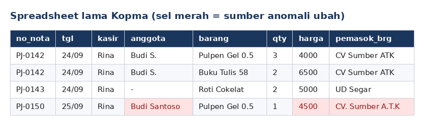
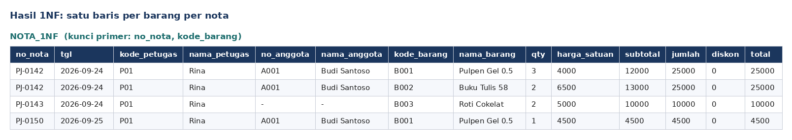
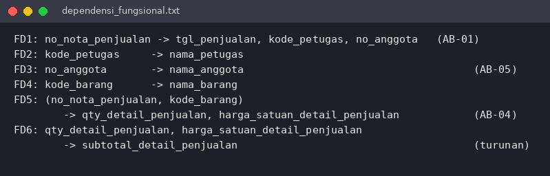
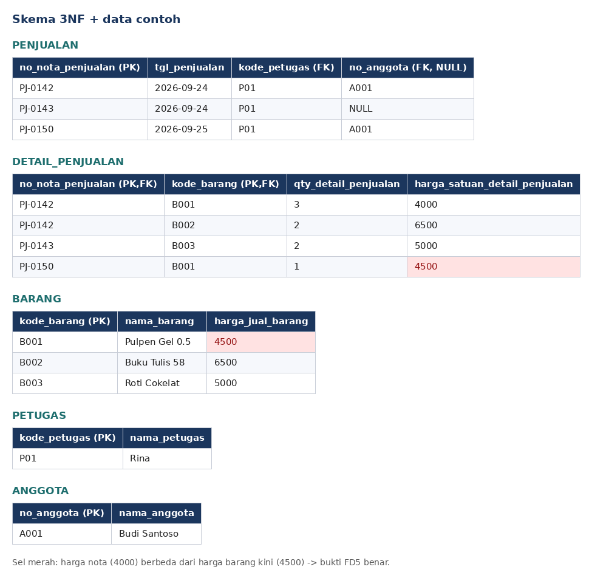
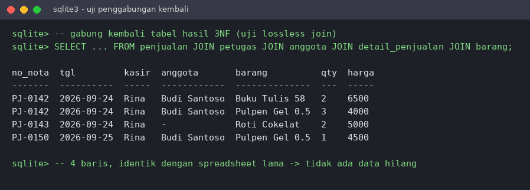
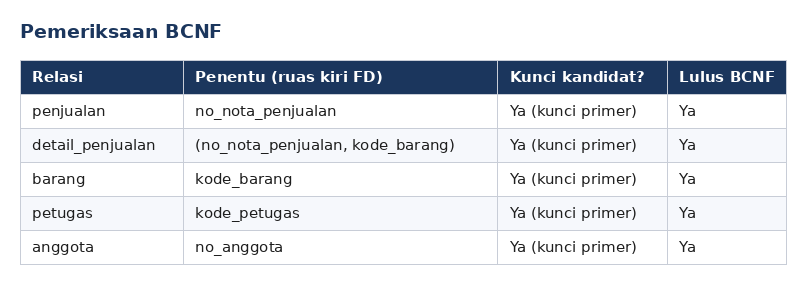
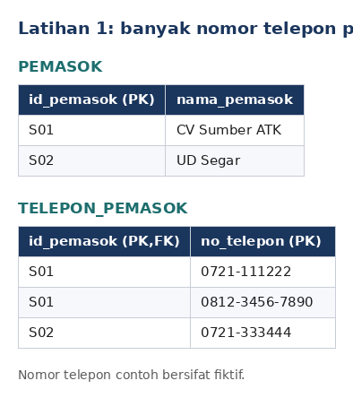
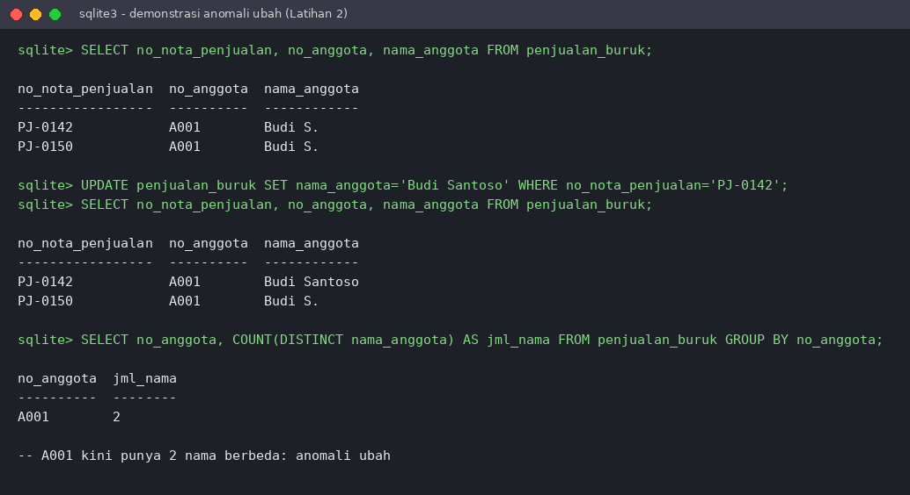

# Laporan Praktikum Basis Data - Pertemuan 04
**Nama:** Hamid Indra Nugroho   **NIM:** 25430029   **Kelas:** B   **Tanggal:** 21 Oktober 2026
**Dosen Pengampu:** Dedi Irawan, S.Kom., M.T.I.

---

## 1. Tujuan Praktikum

Setelah menyelesaikan modul ini, mahasiswa mampu:

1. mengidentifikasi anomali ubah, sisip, dan hapus pada data yang belum dinormalisasi;
2. menuliskan dependensi fungsional dari aturan bisnis;
3. menormalisasi relasi hingga bentuk normal ketiga (3NF) dan memeriksa BCNF;
4. memutuskan penyimpanan nilai turunan dan mendokumentasikan skema relasional akhir.

## 2. Ringkasan Dasar Teori

**Anomali.** Data yang disimpan berulang dalam satu tabel besar menimbulkan tiga anomali. *Anomali ubah*: satu fakta tertulis di banyak baris sehingga bisa tidak konsisten. *Anomali sisip*: fakta tidak dapat dicatat sebelum ada fakta lain. *Anomali hapus*: menghapus satu fakta ikut menghapus fakta lain.

**Dependensi fungsional (FD).** Atribut B bergantung secara fungsional pada A (A → B) jika setiap nilai A selalu menentukan tepat satu nilai B. FD diturunkan dari **aturan bisnis**, bukan dari contoh data, karena contoh data hanya dapat membantah dependensi, tidak dapat membuktikannya.

**Bentuk normal.** Normalisasi dilakukan bertahap; tiap tahap menghilangkan satu jenis ketergantungan yang tidak diinginkan.

| Bentuk | Syarat | Pertanyaan pemeriksa |
|---|---|---|
| 1NF | Semua nilai atomik; tidak ada grup berulang | Adakah sel berisi daftar atau kolom barang1, barang2, ...? |
| 2NF | 1NF dan tidak ada atribut bukan kunci yang bergantung pada sebagian kunci komposit | Adakah atribut yang cukup ditentukan oleh sebagian kunci? |
| 3NF | 2NF dan tidak ada atribut bukan kunci yang bergantung pada atribut bukan kunci lain | Adakah rantai A → B → C di dalam satu tabel? |
| BCNF | Setiap penentu adalah kunci kandidat | Adakah penentu yang bukan kunci kandidat? |

## 3. Hasil Langkah Percobaan

### 3.0 Kondisi awal: spreadsheet lama Kopma

Spreadsheet lama memuat ketiga anomali: nama anggota yang sama ditulis dua cara ("Budi S." dan "Budi Santoso"), nama pemasok yang sama ditulis tidak seragam ("CV Sumber ATK" dan "CV. Sumber A.T.K"), serta harga pulpen yang berbeda pada tanggal berbeda.



| Anomali | Contoh pada spreadsheet |
|---|---|
| Ubah | Nama "Budi S." vs "Budi Santoso"; pemasok ditulis berbeda. Memperbaiki satu baris membuat baris lain tidak konsisten. |
| Sisip | Barang baru tidak bisa dicatat sebelum ada penjualannya, karena barang hanya muncul lewat baris nota. |
| Hapus | Menghapus nota PJ-0143 ikut menghapus informasi pemasok UD Segar (dan barang Roti Cokelat). |

### 3.1 Dari UNF ke 1NF

**Langkah 1: bentuk UNF.** Satu nota menyimpan grup berulang barang.

```
NOTA_UNF (no_nota_penjualan, tgl_penjualan, kode_petugas, nama_petugas, no_anggota, nama_anggota,
          { kode_barang, nama_barang, qty_detail_penjualan,
            harga_satuan_detail_penjualan, subtotal_detail_penjualan },
          jumlah_penjualan, diskon_penjualan, total_penjualan)
```

**Langkah 2: hilangkan grup berulang.** Satu baris untuk setiap barang di setiap nota; kunci primer menjadi komposit `(no_nota_penjualan, kode_barang)`.

```
NOTA_1NF (no_nota_penjualan, tgl_penjualan, kode_petugas, nama_petugas, no_anggota, nama_anggota,
          kode_barang, nama_barang, qty_detail_penjualan, harga_satuan_detail_penjualan,
          subtotal_detail_penjualan, jumlah_penjualan, diskon_penjualan, total_penjualan)
```



*Keterangan:* nota PJ-0142 memiliki dua barang sehingga tampil dua baris. Nilai `diskon_penjualan` diisi 0 pada contoh karena aturan diskon tidak menjadi fokus modul ini. Tahun pada tanggal diasumsikan 2026.

### 3.2 Menuliskan dependensi fungsional

**Langkah 3.** FD diturunkan dari aturan bisnis Pertemuan 2 (AB-01, AB-04, AB-05), bukan dari isi spreadsheet.



### 3.3 Menuju 2NF dan 3NF

**Langkah 4: 2NF.** FD1 dan FD4 hanya bergantung pada sebagian kunci komposit (`no_nota_penjualan` saja, atau `kode_barang` saja). Relasi dipisah: `penjualan` (kunci `no_nota_penjualan`), `barang` (kunci `kode_barang`), dan sisanya menjadi `detail_penjualan`.

**Langkah 5: 3NF.** Di relasi penjualan terdapat rantai `no_nota_penjualan → kode_petugas → nama_petugas` dan `no_nota_penjualan → no_anggota → nama_anggota`. Petugas dan anggota dipisahkan menjadi relasi sendiri.

**Langkah 6: nilai turunan.** `subtotal_detail_penjualan`, `jumlah_penjualan`, dan `total_penjualan` dapat dihitung dari detail dan status anggota. Buku ini memutuskan **tidak menyimpannya** di tabel operasional, sehingga tidak mungkin tidak konsisten.

```
PENJUALAN (no_nota_penjualan, tgl_penjualan, kode_petugas*, no_anggota*, bayar_penjualan)
DETAIL_PENJUALAN (no_nota_penjualan*, kode_barang*, qty_detail_penjualan, harga_satuan_detail_penjualan)
BARANG (kode_barang, nama_barang, kategori_barang, harga_jual_barang, stok_barang, stok_min_barang)
PETUGAS (kode_petugas, nama_petugas, peran_petugas)
ANGGOTA (no_anggota, nim_anggota, nama_anggota, prodi_anggota, no_hp_anggota, status_anggota, tgl_daftar_anggota)
-- garis bawah = kunci primer, * = kunci tamu
```



**Uji penggabungan kembali (lossless join).** Tabel hasil 3NF dibuat di SQLite lalu digabung kembali dengan kunci. Hasilnya identik dengan spreadsheet lama (4 baris), jadi pemisahan tidak menghilangkan data dan tidak ada tabel yang dipecah berlebihan.



### 3.4 Mencocokkan dengan skema kanonik

**Langkah 7: perbandingan dengan skema kanonik Kopma (Tabel 4.2).**

| Aspek | Hasil saya (3NF) | Skema kanonik buku |
|---|---|---|
| Kunci primer | Kunci alami (`no_nota_penjualan`, `kode_barang`, dst.) | Kunci pengganti `id_*` (mis. `id_penjualan`) |
| Kunci unik | Tidak diperlukan (kunci alami sudah primer) | Kode alami tetap unik (`no_nota_penjualan`, `kode_barang`, `kode_petugas`) |
| Kunci tamu | `kode_petugas`, `no_anggota`, dst. | `id_petugas`, `id_anggota`, dst. (anggota boleh NULL) |
| Jumlah tabel | 5 tabel | 8 tabel (ditambah `pemasok`, `pembelian`, `detail_pembelian`) |

Perbedaan utama adalah kunci pengganti `id_*` sebagai kunci primer, sedangkan kode alami menjadi kunci unik. Selain itu, skema kanonik memuat sisi pembelian dan pemasok yang belum masuk ke cakupan relasi penjualan di modul ini. Struktur ketergantungannya sama.

**Langkah 8: pemeriksaan BCNF.**



Seluruh penentu pada kelima relasi adalah kunci primer (yang otomatis kunci kandidat). Tidak ada penentu yang bukan kunci kandidat, sehingga semua relasi memenuhi BCNF.

**Langkah 9.** Seluruh tahap disimpan di `p04_normalisasi_kopma_25430029.md` dan di-commit dengan pesan `p04: normalisasi kopma`.

## 4. Jawaban Titik Analisis

**Titik Analisis 1: Mengapa FD5 menempatkan `harga_satuan_detail_penjualan` pada kunci `(no_nota_penjualan, kode_barang)`, bukan pada `kode_barang` saja? Apa yang terjadi pada laporan omzet tahun lalu jika kolom itu dipindah ke tabel barang?**

Menurut AB-04, harga pada nota dapat berbeda dari harga barang saat ini. Harga yang berlaku saat transaksi ditentukan oleh **nota dan barang sekaligus**, bukan oleh barang saja. Buktinya ada pada data: pulpen dijual Rp4.000 di nota PJ-0142 dan Rp4.500 di PJ-0150, padahal `kode_barang` sama (B001). Jika kolom dipindah ke tabel barang, setiap perubahan harga barang akan mengubah harga seluruh transaksi lama. Laporan omzet tahun lalu (qty × harga) akan dihitung ulang dengan harga baru sehingga **angkanya berubah dan tidak lagi sesuai uang yang benar-benar diterima**.

**Titik Analisis 2: Mengapa keputusan "total tidak disimpan" perlu ditinjau ulang pada tabel arsip penjualan?**

Pada tabel operasional, total yang dihitung ulang selalu mengikuti data terkini sehingga konsisten. Pada **arsip**, tujuannya berbeda: arsip adalah potret historis transaksi yang tidak boleh berubah. Bila total dihitung dari data yang masih dapat berubah (harga, diskon, status anggota), hasilnya bisa berbeda dari total yang dulu tercetak di nota. Karena itu, untuk arsip lebih tepat menyimpan total sebagai nilai tetap (snapshot) agar laporan lampau tetap sama. Kesimpulannya: nilai turunan boleh disimpan pada arsip karena sumbernya bisa berubah, sedangkan data operasional cukup dihitung.

**Titik Analisis 3: Kolom `pemasok_brg` tidak muncul di tabel barang. Di mana informasi "barang ini dipasok oleh siapa" kini disimpan? Apa keuntungannya dibanding menyimpan satu nama pemasok di tabel barang?**

Informasi pemasok disimpan lewat sisi pembelian: `pembelian` memiliki kunci tamu `id_pemasok`, dan `detail_pembelian` mencatat barang apa yang dibeli pada pembelian tersebut. Jadi hubungan barang dan pemasok diketahui dari riwayat pembelian.

Keuntungannya:
- satu barang dapat dipasok oleh lebih dari satu pemasok, dan pemasok bisa berganti seiring waktu, tanpa mengubah struktur tabel;
- nama pemasok ditulis sekali di tabel `pemasok`, sehingga masalah "CV Sumber ATK" vs "CV. Sumber A.T.K" hilang (anomali ubah dicegah);
- riwayat pemasok tiap pembelian tetap tersimpan.

Kekurangannya, menampilkan pemasok suatu barang membutuhkan `JOIN` beberapa tabel.

## 5. Hasil Latihan dan Modifikasi

**Latihan 1: Kopma ingin mencatat beberapa nomor telepon untuk setiap pemasok.**

Nomor telepon adalah atribut **multinilai**; jika disimpan dalam satu kolom `pemasok`, 1NF dilanggar. Solusinya, nomor telepon dipisah menjadi relasi sendiri dengan kunci komposit:

```
PEMASOK (id_pemasok, nama_pemasok)
TELEPON_PEMASOK (id_pemasok*, no_telepon)
-- garis bawah = kunci primer: (id_pemasok, no_telepon); * = kunci tamu ke PEMASOK
```



Relasi baru memenuhi 3NF dan BCNF: tidak ada atribut bukan kunci, sehingga tidak ada ketergantungan parsial maupun transitif.

**Latihan 2: Contoh data yang melanggar 3NF jika `nama_anggota` disimpan di tabel penjualan, beserta kueri yang menunjukkan anomali ubah.**

Pelanggaran: `no_nota_penjualan → no_anggota → nama_anggota` adalah ketergantungan transitif, karena `nama_anggota` ditentukan oleh `no_anggota` (bukan kunci), bukan langsung oleh kunci `no_nota_penjualan`.

Contoh data (tabel `penjualan_buruk`): anggota A001 muncul di dua nota dengan nama yang sama. Mengoreksi nama hanya di satu nota (`PJ-0142`) menyisakan A001 dengan dua nama berbeda.

```sql
UPDATE penjualan_buruk
SET nama_anggota = 'Budi Santoso'
WHERE no_nota_penjualan = 'PJ-0142';

SELECT no_anggota, COUNT(DISTINCT nama_anggota) AS jml_nama
FROM penjualan_buruk GROUP BY no_anggota;   -- hasil: A001 memiliki 2 nama
```



Pada skema 3NF, nama anggota hanya ada di tabel `anggota`, sehingga satu `UPDATE` cukup dan anomali tidak terjadi.

## 6. Tugas Mandiri: Milestone Proyek 04

> **PERHATIAN: bagian ini wajib diganti dengan proyek Anda sendiri.** Buku menyatakan dokumen sumber, FD, dan keputusan nilai turunan harus berasal dari aturan bisnis Anda sendiri, dan akan diperiksa melalui *viva*. Isi di bawah hanyalah **contoh kerangka** (proyek fiktif "Peminjaman Alat Laboratorium") agar format jawabannya jelas. Hapus catatan ini setelah diganti.

**a. Dokumen sumber (titik awal UNF).** [CONTOH]

```
PEMINJAMAN_UNF (no_peminjaman, tgl_pinjam, nim_peminjam, nama_peminjam, kode_petugas, nama_petugas,
                { kode_alat, nama_alat, jumlah_pinjam, kondisi_keluar },
                tgl_kembali, denda_total)
```

**b. Dependensi fungsional beserta kode AB.** [CONTOH]

```
FD1: no_peminjaman -> tgl_pinjam, nim_peminjam, kode_petugas, tgl_kembali        (AB-01)
FD2: nim_peminjam  -> nama_peminjam                                              (AB-02)
FD3: kode_petugas  -> nama_petugas                                               (AB-03)
FD4: kode_alat     -> nama_alat                                                  (AB-04)
FD5: (no_peminjaman, kode_alat) -> jumlah_pinjam, kondisi_keluar                 (AB-05)
```

**c. Tahapan 1NF, 2NF, 3NF dan hasil BCNF.**

| Tahap | Tindakan | Hasil |
|---|---|---|
| 1NF | Hilangkan grup `{kode_alat, ...}` | Kunci `(no_peminjaman, kode_alat)` |
| 2NF | Pisahkan `alat` (FD4) dan `peminjaman` (FD1) | `peminjaman`, `alat`, `detail_peminjaman` |
| 3NF | Pisahkan `peminjam` (FD2) dan `petugas` (FD3) | 5 relasi |
| BCNF | Periksa tiap penentu | Seluruh penentu adalah kunci kandidat |

**d. Keputusan penyimpanan nilai turunan.** [CONTOH] `denda_total` **tidak disimpan** karena dapat dihitung dari selisih tanggal kembali dan tarif harian, sehingga tidak berisiko tidak konsisten. Jika denda perlu dibekukan saat nota ditutup, ditinjau ulang pada arsip (lihat Titik Analisis 2).

**e. ERD proyek diperbarui.** [LAMPIRKAN GAMBAR ERD BARU DAN CATAT PERUBAHANNYA DI p04_normalisasi_25430029.md]

## 7. Pembahasan dan Kendala

**Pembahasan.**
1. Normalisasi bertujuan menghilangkan anomali, bukan memperbanyak tabel. Dari satu spreadsheet, hasilnya lima relasi (penjualan) atau delapan tabel pada skema kanonik penuh. Pemisahan terbukti aman lewat uji penggabungan kembali yang menghasilkan data identik.
2. FD harus diturunkan dari aturan bisnis. Contoh nyata: harga pulpen di spreadsheet berbeda (4.000 dan 4.500), sehingga `kode_barang → harga_satuan` salah, dan harga nota tepat diletakkan pada `detail_penjualan`.
3. Nilai turunan (subtotal, jumlah, total) tidak disimpan pada tabel operasional agar tidak bisa tidak konsisten, namun perlu ditinjau ulang pada arsip historis.
4. Kunci pengganti (`id_*`) tidak otomatis menyelesaikan normalisasi. Ketergantungan fungsional pada kunci alami (mis. `nim_anggota`) tetap harus diperiksa.

**Kendala dan solusi.**

| Kendala | Solusi |
|---|---|
| Tergoda menyimpulkan FD dari contoh data (semua harga pulpen Rp4.000) | Kembali ke aturan bisnis AB-04; contoh data hanya bisa membantah FD |
| Ragu apakah pemecahan tabel sudah berlebihan | Gabungkan kembali dengan kunci; tidak ada data hilang dan tidak ada anomali yang tersisa berarti pemecahan cukup |
| Perbedaan hasil dengan skema kanonik (kunci pengganti) | Dicatat sebagai perbedaan desain kunci, bukan kesalahan struktur ketergantungan |

## 8. Kesimpulan

1. Spreadsheet lama Kopma mengandung anomali ubah, sisip, dan hapus akibat data berulang dalam satu tabel.
2. Normalisasi UNF → 1NF → 2NF → 3NF menghasilkan relasi `penjualan`, `detail_penjualan`, `barang`, `petugas`, dan `anggota` yang seluruhnya memenuhi BCNF.
3. Harga satuan pada nota harus tetap berada di `detail_penjualan` agar riwayat transaksi tidak berubah ketika harga barang berubah.
4. Nilai turunan tidak disimpan pada tabel operasional, tetapi dapat disimpan pada arsip sebagai potret historis.
5. Skema hasil modul ini dapat dibandingkan dengan skema kanonik Kopma dan menjadi dasar skrip DDL pada Pertemuan 5, di mana setiap kunci dan aturan muncul sebagai *constraint*.

## 9. Pernyataan Penggunaan AI

> **Isi sesuai kenyataan.** Contoh di bawah menyatakan penggunaan AI untuk menyusun draf; ubah jika tidak sesuai dengan yang Anda lakukan.

Saya menggunakan asisten AI (Claude, Anthropic) untuk membantu menyusun draf laporan ini, termasuk kerangka jawaban dan pembuatan gambar bukti dari contoh data. Saya telah membaca seluruh isi, memahami alasan di balik setiap keputusan normalisasi, serta memeriksa kebenaran dependensi fungsional dan hasilnya. Bagian Milestone Proyek 04 saya susun berdasarkan aturan bisnis proyek saya sendiri.

## 10. Bukti Git

- Repositori: `[TAUTAN https://github.com/.../basisdata-25430029]`
- Berkas: `p04_normalisasi_kopma_25430029.md`, `laporan/p04_laporan_25430029.md`
- Pesan commit: `p04: normalisasi kopma`
- Hash commit: `[ISI HASH dari git log -1 --format=%h]`

## Checklist

- [ ] Berkas wajib: `p04_normalisasi_25430029.md` (proyek)
- [ ] Bukti tangkapan layar: tabel tahapan UNF → 1NF → 2NF → 3NF
- [ ] Analisis wajib: daftar dependensi fungsional; keputusan menyimpan atau menghitung nilai turunan beserta alasannya
- [ ] Checklist umum sesuai Pedoman dan Checklist Laporan Praktikum
