# Laporan Praktikum Basis Data - Pertemuan 05
**Nama:** Hamid Indra Nugroho   **NIM:** 25430029   **Kelas:** B   **Tanggal:** 27–28 Oktober 2026
**Dosen Pengampu:** Dedi Irawan, S.Kom., M.T.I.
**Topik:** Modul 5 – Membangun Struktur dengan DDL dan Constraint

---

## 1. Tujuan Praktikum

Setelah menyelesaikan praktikum ini, mahasiswa mampu:

1. Menerjemahkan skema relasional 3NF menjadi perintah `CREATE TABLE` dengan tipe data yang tepat.
2. Menerapkan constraint `PRIMARY KEY`, `FOREIGN KEY`, `UNIQUE`, `NOT NULL`, `DEFAULT`, dan `CHECK` sesuai aturan bisnis.
3. Mengubah dan menghapus struktur dengan `ALTER TABLE` dan `DROP TABLE` dalam urutan yang benar.
4. Membuktikan bahwa constraint menolak data yang melanggar aturan, lalu membandingkan desain fisik dengan ERD.

**Konteks proyek.** Pada laporan ini, studi kasus diwujudkan sebagai basis data **`perpus_029`** (sistem perpustakaan) dengan akun **`dev_029`**. Seluruh langkah pada modul diterapkan pada skema perpustakaan yang terdiri dari 12 tabel.

---

## 2. Ringkasan Dasar Teori

### 2.1 DDL dan pemilihan tipe data
*Data Definition Language* (DDL) adalah bagian SQL untuk membuat, mengubah, dan menghapus struktur basis data. Tipe data adalah keputusan desain: tipe yang terlalu besar memboroskan ruang, sedangkan tipe yang terlalu kecil menolak data yang sah.

| Elemen | Tipe yang dipakai | Alasan |
|---|---|---|
| `nim_anggota` | `CHAR(8)` | Panjang tetap 8, berupa kode (bukan angka yang dihitung), nol di depan tidak hilang |
| `nidn_anggota` | `CHAR(10)` | Panjang tetap 10, berupa kode identitas dosen |
| `nomor_peminjaman` | `CHAR(13)` | Format tetap `PJM-YYMM-nnnn` |
| `nomor_sanksi` | `CHAR(11)` | Format tetap `SK-YYMM-nnn` |
| `nominal_sanksi` | `DECIMAL(12,2)` | Uang wajib tepat; `FLOAT` menimbulkan galat pembulatan |
| `tanggal_*` | `DATE` | Pencatatan cukup pada tingkat hari |
| `status_*`, `jenis_*`, `kondisi_*` | `ENUM(...)` | Nilai terbatas dan sudah diketahui |
| `id_petugas` | `SMALLINT` | Jumlah petugas kecil; tipe kunci tamu harus **sama persis** dengan kolom induknya |

### 2.2 Constraint sebagai aturan bisnis
Constraint memindahkan aturan bisnis dari "disiplin pengguna" ke "jaminan server". Sejak MariaDB 10.2, constraint `CHECK` benar-benar ditegakkan sehingga aturan seperti nilai tidak boleh negatif dijaga langsung oleh server.

| Constraint | Fungsi |
|---|---|
| `NOT NULL` | Kolom wajib diisi |
| `PRIMARY KEY` | Identitas unik setiap baris |
| `UNIQUE` | Nilai tidak boleh kembar |
| `FOREIGN KEY` | Menjaga integritas referensial antar tabel |
| `CHECK` | Aturan validasi nilai pada satu baris |
| `DEFAULT` | Nilai awal bila kolom tidak diisi |

### 2.3 Urutan membuat dan menghapus tabel
Tabel induk harus dibuat **sebelum** tabel anak yang merujuknya, dan dihapus **setelahnya**. Urutan penghapusan adalah kebalikan dari urutan pembuatan.

### 2.4 Kebijakan penamaan
Nama constraint mengikuti pola `pk_`, `fk_`, `uq_`, `ck_` ditambah nama tabel. Khusus *primary key*, MariaDB selalu menamainya `PRIMARY` sehingga pola `pk_` tidak dapat diterapkan pada PK.

---

## 3. Hasil Langkah Percobaan

**Lingkungan:** XAMPP (Windows), MariaDB 10.4.32, PHP 8.2.12, Apache 2.4.58, phpMyAdmin 5.2.1.

### 3.1 Verifikasi akun dan hak akses

Akun `dev_029@localhost` memperoleh `ALL PRIVILEGES` pada basis data `kopma` dan `perpus_029`. Login dilakukan dengan `mysql -u dev_029 -p perpus_029`, lalu identitas sesi diverifikasi.

```sql
SHOW GRANTS FOR 'dev_029'@'localhost';
SELECT CURRENT_USER(), NOW();
```

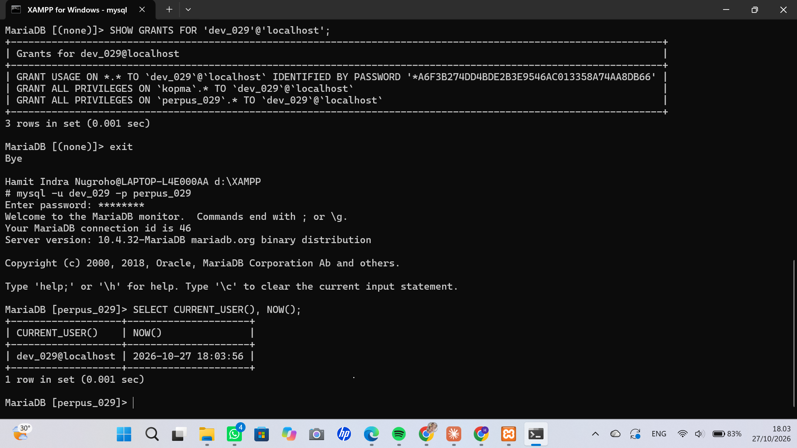

*Keterangan:* `CURRENT_USER()` menghasilkan `dev_029@localhost` pada 2026-10-27 18:03:56, sehingga seluruh pekerjaan berikutnya terbukti dilakukan dengan akun milik sendiri.

### 3.2 Menjalankan skrip DDL

Skrip `p05_ddl_25430029.sql` dijalankan dari basis data yang sudah ada, lalu `SHOW TABLES` dipakai untuk memeriksa hasilnya.

```bash
mysql -u dev_029 -p perpus_029 < p05_ddl_25430029.sql
```

```sql
SHOW TABLES;
```

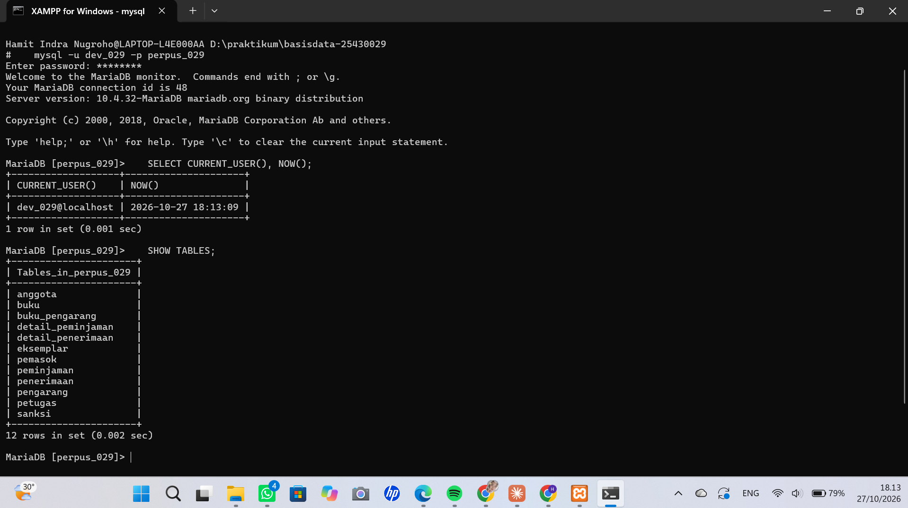

*Keterangan:* Terbentuk 12 tabel: `anggota`, `buku`, `buku_pengarang`, `detail_peminjaman`, `detail_penerimaan`, `eksemplar`, `pemasok`, `peminjaman`, `penerimaan`, `pengarang`, `petugas`, dan `sanksi`.

### 3.3 Skrip dapat dijalankan ulang

Skrip yang sama dijalankan sekali lagi pada basis data yang sudah berisi tabel. Perintah selesai tanpa pesan galat apa pun (tidak muncul `ERROR 1050 Table already exists`), yang membuktikan bahwa skrip memuat pembersihan `DROP TABLE IF EXISTS` di awal.

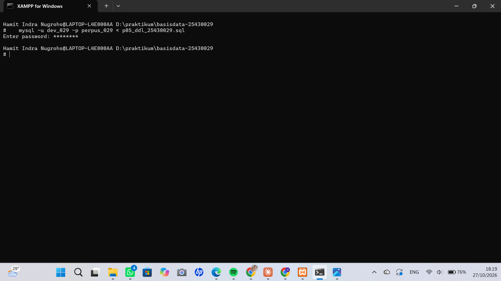

### 3.4 Memeriksa struktur utama dengan `SHOW CREATE TABLE`

#### a. Tabel `peminjaman`

```sql
SHOW CREATE TABLE peminjaman\G
```

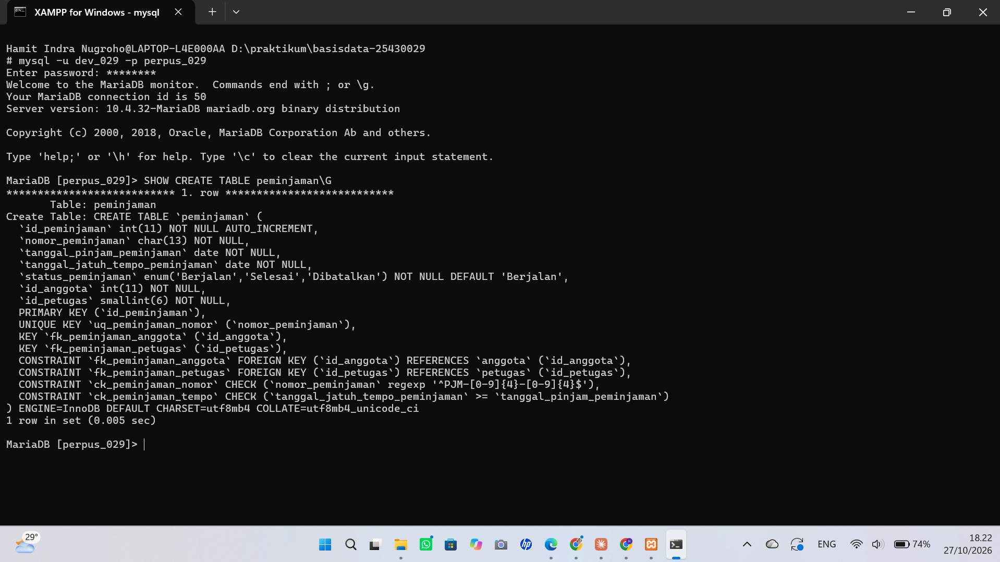

| Elemen | Definisi | Makna |
|---|---|---|
| PK | `PRIMARY KEY (id_peminjaman)` + `AUTO_INCREMENT` | Identitas nota peminjaman dibuat otomatis |
| Unik | `uq_peminjaman_nomor` | Nomor peminjaman tidak boleh kembar |
| FK | `fk_peminjaman_anggota`, `fk_peminjaman_petugas` | Peminjam dan petugas harus terdaftar |
| CHECK | `ck_peminjaman_nomor` — `nomor_peminjaman REGEXP '^PJM-[0-9]{4}-[0-9]{4}$'` | Format nomor dijaga server |
| CHECK | `ck_peminjaman_tempo` — `tanggal_jatuh_tempo >= tanggal_pinjam` | Jatuh tempo tidak boleh mendahului tanggal pinjam |
| DEFAULT | `status_peminjaman` = `'Berjalan'` | Status awal otomatis |

#### b. Tabel `detail_peminjaman`

```sql
SHOW CREATE TABLE detail_peminjaman\G
```

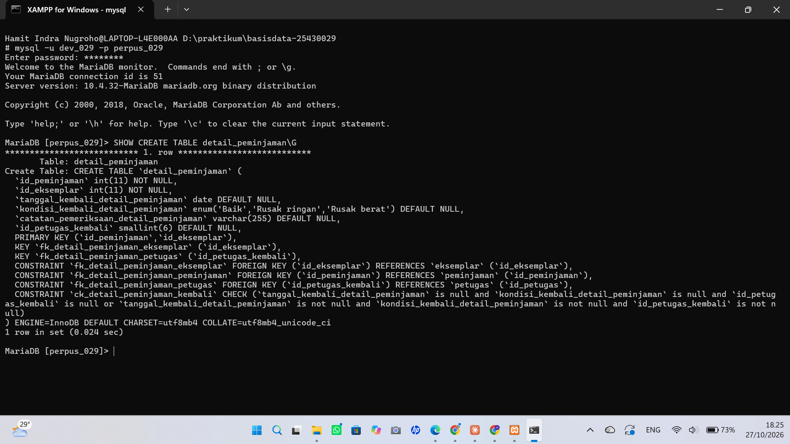

| Elemen | Definisi | Makna |
|---|---|---|
| PK komposit | `PRIMARY KEY (id_peminjaman, id_eksemplar)` | Satu eksemplar hanya tercatat sekali per nota |
| FK | `fk_detail_peminjaman_peminjaman`, `fk_detail_peminjaman_eksemplar`, `fk_detail_peminjaman_petugas` | Induk nota, eksemplar, dan petugas pengembalian harus ada |
| CHECK | `ck_detail_peminjaman_kembali` | Tanggal kembali, kondisi kembali, dan petugas kembali harus **semuanya kosong** atau **semuanya terisi** |

#### c. Tabel `anggota`

```sql
SHOW CREATE TABLE anggota\G
```

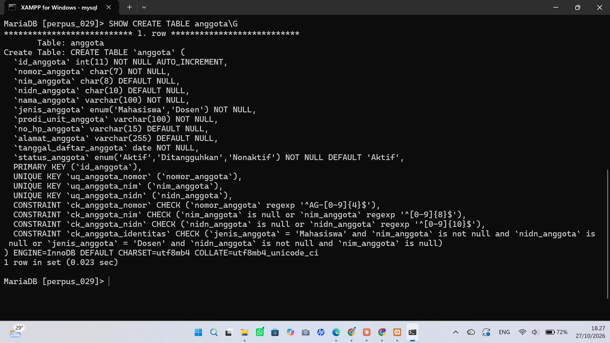

| Constraint | Aturan |
|---|---|
| `uq_anggota_nomor`, `uq_anggota_nim`, `uq_anggota_nidn` | Nomor anggota, NIM, dan NIDN tidak boleh kembar |
| `ck_anggota_nomor` | Format `AG-nnnn` |
| `ck_anggota_nim` | NIM kosong atau tepat 8 digit |
| `ck_anggota_nidn` | NIDN kosong atau tepat 10 digit |
| `ck_anggota_identitas` | Mahasiswa wajib ber-NIM dan tidak ber-NIDN; Dosen wajib ber-NIDN dan tidak ber-NIM |
| DEFAULT | `status_anggota` = `'Aktif'` |

#### d. Tabel `sanksi`

```sql
SHOW CREATE TABLE sanksi\G
```

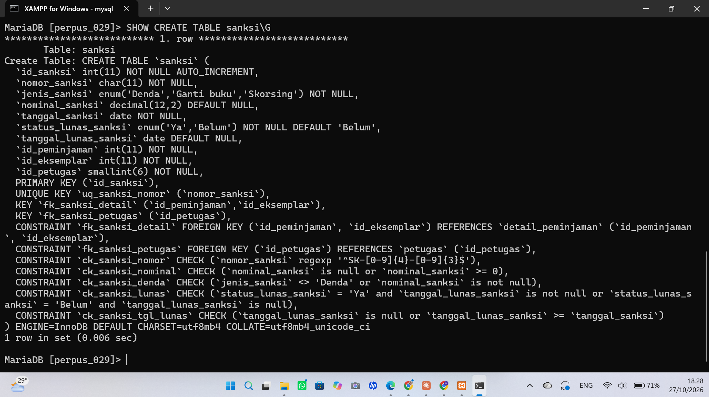

| Constraint | Aturan |
|---|---|
| `fk_sanksi_detail` | FK **komposit** `(id_peminjaman, id_eksemplar)` → `detail_peminjaman`; sanksi hanya untuk eksemplar yang benar-benar dipinjam |
| `fk_sanksi_petugas` | Petugas pencatat harus terdaftar |
| `ck_sanksi_nomor` | Format `SK-nnnn-nnn` |
| `ck_sanksi_nominal` | Nominal kosong atau ≥ 0 |
| `ck_sanksi_denda` | Jenis `Denda` wajib memiliki nominal |
| `ck_sanksi_lunas` | Status `Ya` wajib ber-tanggal lunas; status `Belum` wajib tanpa tanggal lunas |
| `ck_sanksi_tgl_lunas` | Tanggal lunas tidak boleh mendahului tanggal sanksi |
| DEFAULT | `status_lunas_sanksi` = `'Belum'` |

### 3.5 Inventaris seluruh constraint

Seluruh constraint pada skema diambil dari `information_schema`:

```sql
SELECT TABLE_NAME, CONSTRAINT_NAME, CONSTRAINT_TYPE
FROM information_schema.TABLE_CONSTRAINTS
WHERE TABLE_SCHEMA = 'perpus_029'
ORDER BY TABLE_NAME, CONSTRAINT_TYPE;
```

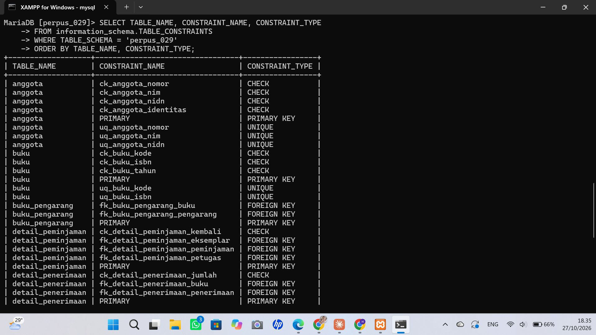

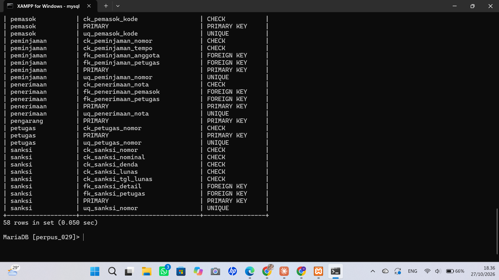

*Keterangan:* Hasil berjumlah **58 constraint**. Rinciannya per tabel:

| Tabel | Jumlah | Tabel | Jumlah |
|---|---:|---|---:|
| `anggota` | 8 | `penerimaan` | 5 |
| `buku` | 6 | `pengarang` | 1 |
| `buku_pengarang` | 3 | `petugas` | 3 |
| `detail_peminjaman` | 5 | `sanksi` | 9 |
| `detail_penerimaan` | 4 | `eksemplar` | 5\* |
| `pemasok` | 3 | **Total** | **58** |
| `peminjaman` | 6 | | |

\* Baris `eksemplar` berada di antara dua tangkapan layar; rinciannya (diverifikasi lewat `information_schema`): `PRIMARY`, `uq_eksemplar_no`, `ck_eksemplar_no`, `ck_eksemplar_berat`, dan `fk_eksemplar_buku`.

Seluruh nama constraint mengikuti pola `ck_`, `fk_`, `uq_` ditambah nama tabel; satu-satunya pengecualian adalah primary key yang oleh MariaDB selalu bernama `PRIMARY`.

### 3.6 Mengisi data induk

Data minimal dimasukkan sesuai urutan induk → anak agar seluruh FK terpenuhi.

```sql
INSERT INTO petugas (nomor_petugas, nama_petugas, peran_petugas) VALUES
  ('PT-01', 'Hamid Kepala Perpustakaan', 'Kepala'),
  ('PT-02', 'Rina Petugas Layanan',      'Petugas');

INSERT INTO anggota (nomor_anggota, nim_anggota, nama_anggota, jenis_anggota,
                     prodi_unit_anggota, tanggal_daftar_anggota) VALUES
  ('AG-0123', '25430029', 'Dewi Anjani', 'Mahasiswa', 'Ilmu Komputer', '2026-09-02');

INSERT INTO buku (kode_buku, isbn_buku, judul_buku, penerbit_buku, tahun_terbit_buku, kategori_buku) VALUES
  ('BK-0045', '9786020000000', 'Basis Data', 'Informatika', 2016, 'Komputer');

INSERT INTO eksemplar (no_eksemplar, tanggal_masuk_eksemplar, id_buku) VALUES
  ('EKS-000231', '2026-09-01', 1);

INSERT INTO peminjaman (nomor_peminjaman, tanggal_pinjam_peminjaman,
                        tanggal_jatuh_tempo_peminjaman, id_anggota, id_petugas)
VALUES ('PJM-2610-0007', '2026-10-06', '2026-10-13', 1, 2);

INSERT INTO detail_peminjaman (id_peminjaman, id_eksemplar) VALUES (1, 1);
```

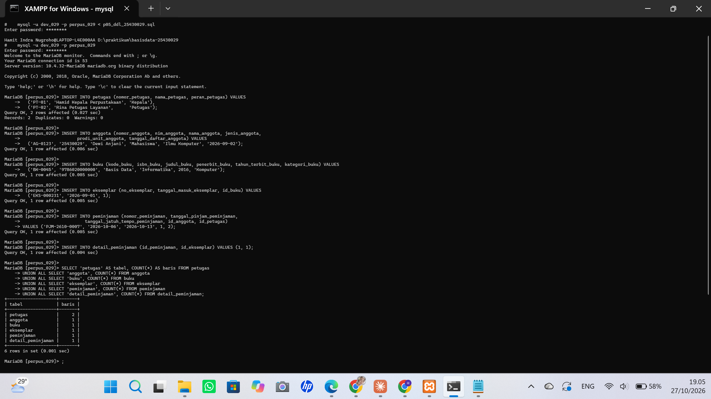

*Keterangan:* Semua `INSERT` berhasil (`Query OK`). Rekap `UNION ALL` menunjukkan `petugas` = 2 baris serta `anggota`, `buku`, `eksemplar`, `peminjaman`, dan `detail_peminjaman` masing-masing 1 baris.

### 3.7 Uji negatif: pelanggaran harus ditolak

Setiap perintah di bawah ini **sengaja** melanggar satu aturan. Constraint dianggap bekerja bila server menolak.

#### a. Pelanggaran FOREIGN KEY dan UNIQUE

```sql
-- B1: petugas 99 tidak ada
INSERT INTO peminjaman (nomor_peminjaman, tanggal_pinjam_peminjaman,
                        tanggal_jatuh_tempo_peminjaman, id_anggota, id_petugas)
VALUES ('PJM-2610-0099', '2026-10-06', '2026-10-13', 1, 99);

-- B2: NIM kembar
INSERT INTO anggota (nomor_anggota, nim_anggota, nama_anggota, jenis_anggota,
                     prodi_unit_anggota, tanggal_daftar_anggota)
VALUES ('AG-0999', '25430029', 'Duplikat NIM', 'Mahasiswa', 'Ilmu Komputer', '2026-10-01');
```

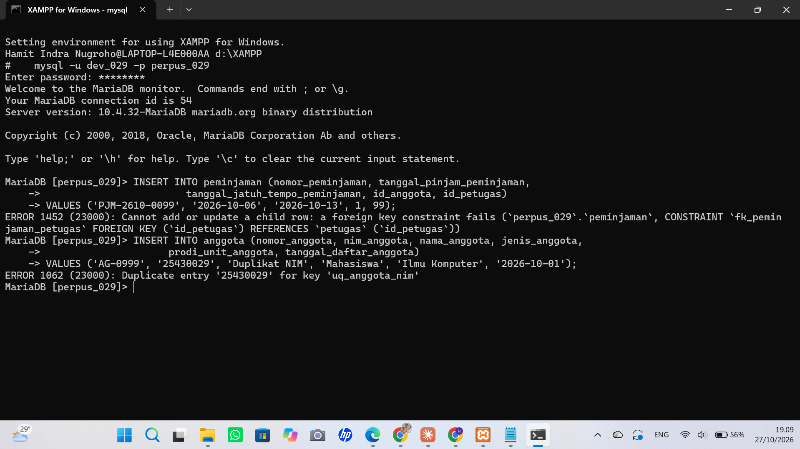

#### b. Pelanggaran CHECK

```sql
-- B3: Mahasiswa tanpa NIM
INSERT INTO anggota (nomor_anggota, nama_anggota, jenis_anggota,
                     prodi_unit_anggota, tanggal_daftar_anggota)
VALUES ('AG-0998', 'Tanpa NIM', 'Mahasiswa', 'Ilmu Komputer', '2026-10-01');

-- B4: eksemplar Rusak berat tetapi berstatus Dipinjam
INSERT INTO eksemplar (no_eksemplar, kondisi_eksemplar, status_eksemplar,
                       tanggal_masuk_eksemplar, id_buku)
VALUES ('EKS-000999', 'Rusak berat', 'Dipinjam', '2026-09-01', 1);

-- B5: jatuh tempo mendahului tanggal pinjam
INSERT INTO peminjaman (nomor_peminjaman, tanggal_pinjam_peminjaman,
                        tanggal_jatuh_tempo_peminjaman, id_anggota, id_petugas)
VALUES ('PJM-2610-0098', '2026-10-06', '2026-10-01', 1, 2);

-- B6: tanggal kembali diisi tanpa kondisi dan petugas
UPDATE detail_peminjaman
   SET tanggal_kembali_detail_peminjaman = '2026-10-15'
 WHERE id_peminjaman = 1 AND id_eksemplar = 1;

-- B7: sanksi Denda tanpa nominal
INSERT INTO sanksi (nomor_sanksi, jenis_sanksi, tanggal_sanksi,
                    id_peminjaman, id_eksemplar, id_petugas)
VALUES ('SK-2610-003', 'Denda', '2026-10-15', 1, 1, 1);
```

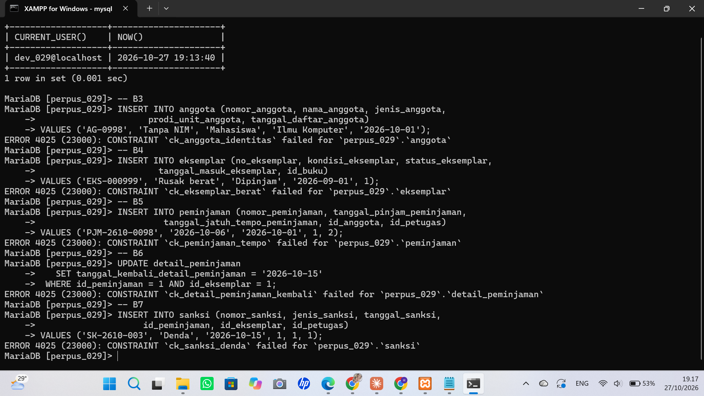

#### c. Pelanggaran CHECK pada tabel penerimaan

Pemasok dan nota penerimaan berhasil dimasukkan, tetapi baris detail dengan jumlah 0 ditolak.

```sql
INSERT INTO pemasok (kode_pemasok, nama_pemasok) VALUES ('PS-007', 'Penerbit Informatika');
INSERT INTO penerimaan (nomor_nota_penerimaan, tanggal_terima_penerimaan, id_pemasok, id_petugas)
VALUES ('NT-2609-015', '2026-09-01', 1, 2);
INSERT INTO detail_penerimaan (id_penerimaan, id_buku, jumlah_diterima_detail_penerimaan)
VALUES (1, 1, 0);
```

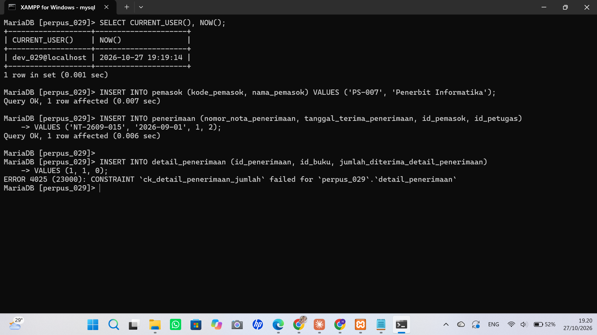

#### d. Pelanggaran integritas saat menghapus data induk

```sql
DELETE FROM petugas    WHERE id_petugas    = 2;
DELETE FROM peminjaman WHERE id_peminjaman = 1;
```

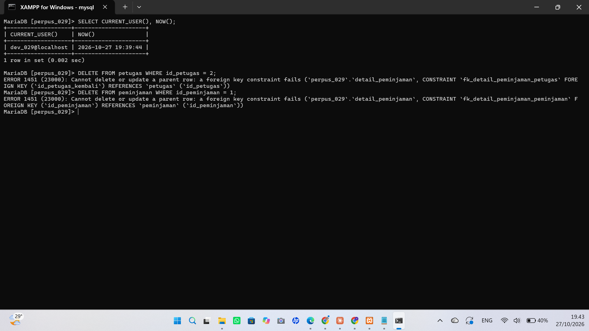

*Keterangan:* Pengujian ini dijalankan setelah uji positif (bagian 3.8), sehingga baris `detail_peminjaman` sudah memuat `id_petugas_kembali = 2`.

#### Rekap uji negatif

| No | Skenario pelanggaran | Kode galat | Constraint yang menolak |
|---:|---|:---:|---|
| 1 | Peminjaman dengan petugas yang tidak ada (`id_petugas = 99`) | 1452 | `fk_peminjaman_petugas` |
| 2 | Anggota dengan NIM kembar | 1062 | `uq_anggota_nim` |
| 3 | Mahasiswa tanpa NIM | 4025 | `ck_anggota_identitas` |
| 4 | Eksemplar *Rusak berat* berstatus *Dipinjam* | 4025 | `ck_eksemplar_berat` |
| 5 | Jatuh tempo lebih awal dari tanggal pinjam | 4025 | `ck_peminjaman_tempo` |
| 6 | Tanggal kembali terisi tanpa kondisi dan petugas | 4025 | `ck_detail_peminjaman_kembali` |
| 7 | Sanksi *Denda* tanpa nominal | 4025 | `ck_sanksi_denda` |
| 8 | Penerimaan buku berjumlah 0 | 4025 | `ck_detail_penerimaan_jumlah` |
| 9 | Menghapus petugas yang sudah tercatat pada detail peminjaman | 1451 | `fk_detail_peminjaman_petugas` |
| 10 | Menghapus nota peminjaman yang masih punya detail | 1451 | `fk_detail_peminjaman_peminjaman` |

**Hasil:** 10 dari 10 pelanggaran ditolak oleh server.

### 3.8 Uji positif: data sah harus diterima

Agar pengujian tidak hanya membuktikan penolakan, data yang **memenuhi** aturan dimasukkan.

```sql
UPDATE detail_peminjaman
   SET tanggal_kembali_detail_peminjaman = '2026-10-15',
       kondisi_kembali_detail_peminjaman = 'Rusak ringan',
       id_petugas_kembali = 2
 WHERE id_peminjaman = 1 AND id_eksemplar = 1;

INSERT INTO sanksi (nomor_sanksi, jenis_sanksi, nominal_sanksi, tanggal_sanksi,
                    id_peminjaman, id_eksemplar, id_petugas)
VALUES ('SK-2610-003', 'Denda', 6000, '2026-10-15', 1, 1, 1);

SELECT id_sanksi, nomor_sanksi, jenis_sanksi, nominal_sanksi, status_lunas_sanksi
FROM sanksi;
```

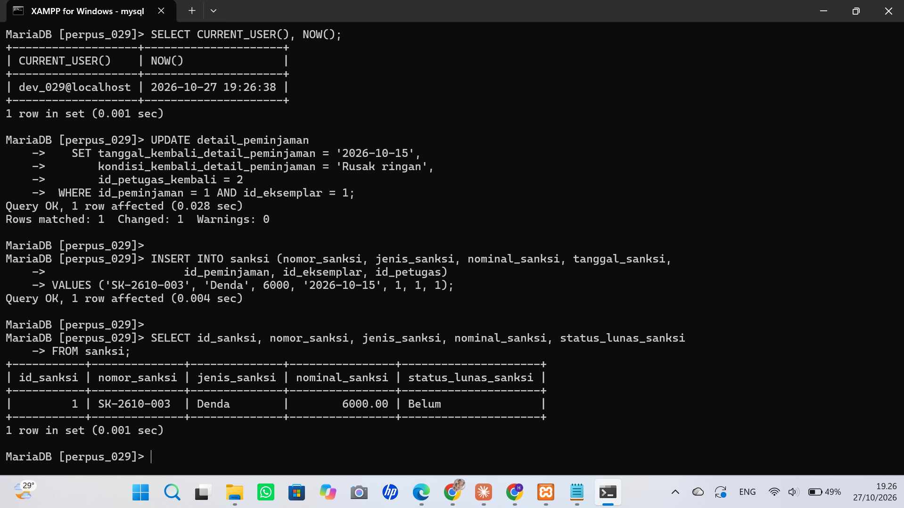

*Keterangan:* `UPDATE` mengubah 1 baris (`Rows matched: 1  Changed: 1`) karena ketiga kolom pengembalian terisi bersamaan. `INSERT` sanksi yang sebelumnya ditolak (B7) kini diterima setelah nominal diisi. `status_lunas_sanksi` terisi `Belum` secara otomatis oleh `DEFAULT`, dan nominal tersimpan sebagai `6000.00` karena bertipe `DECIMAL(12,2)`.

### 3.9 Mengubah struktur dengan `ALTER TABLE`

Kolom opsional `edisi_buku` ditambahkan setelah `penerbit_buku`, diperiksa dengan `DESCRIBE`, lalu dibatalkan.

```sql
DESCRIBE buku;
ALTER TABLE buku ADD COLUMN edisi_buku VARCHAR(20) NULL AFTER penerbit_buku;
DESCRIBE buku;
```

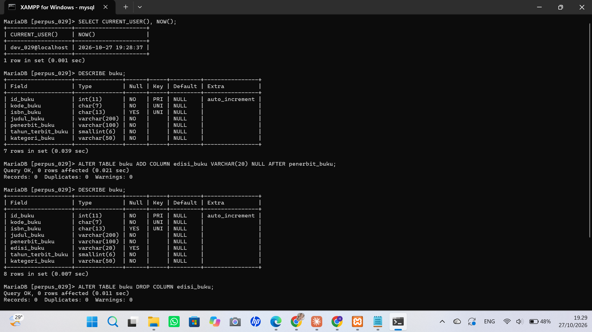

```sql
ALTER TABLE buku DROP COLUMN edisi_buku;   -- dibatalkan setelah dicoba
DESCRIBE buku;
```

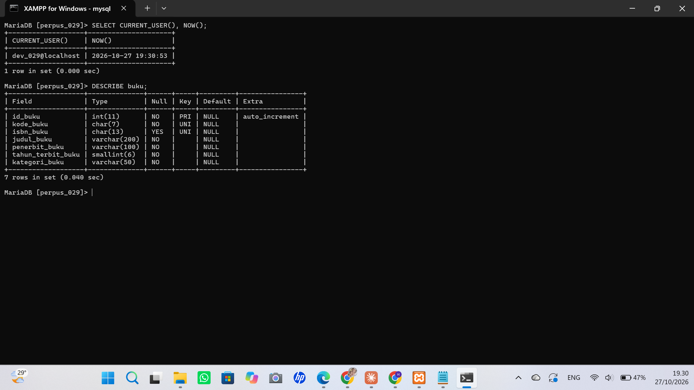

*Keterangan:* Sebelum `ALTER`, tabel `buku` memiliki 7 kolom; setelah `ADD COLUMN` menjadi 8 kolom dengan `edisi_buku` tepat di bawah `penerbit_buku`; setelah `DROP COLUMN` kembali ke 7 kolom seperti semula. Kolom dibuat `NULL` agar baris lama tidak melanggar aturan.

### 3.10 Membandingkan desain fisik dengan Designer phpMyAdmin

Tabel disusun pada menu **Designer** phpMyAdmin untuk memeriksa kesesuaian relasi dengan ERD.

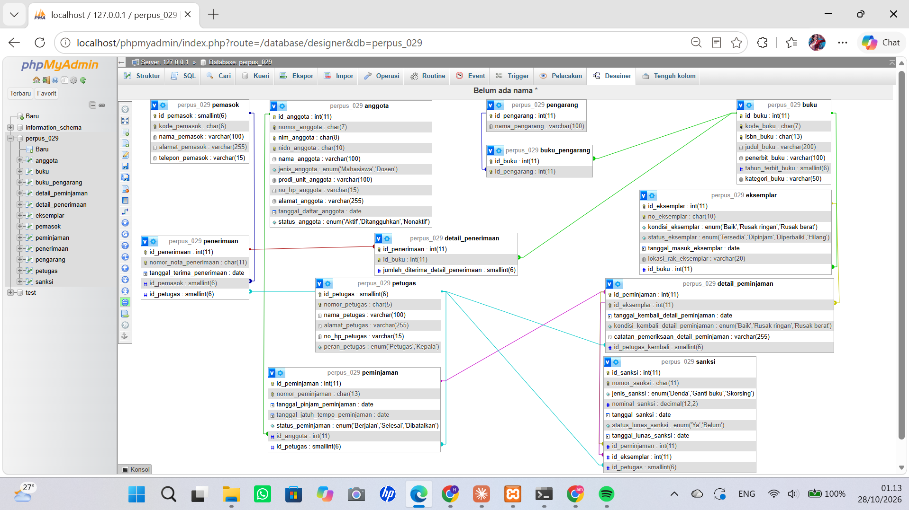

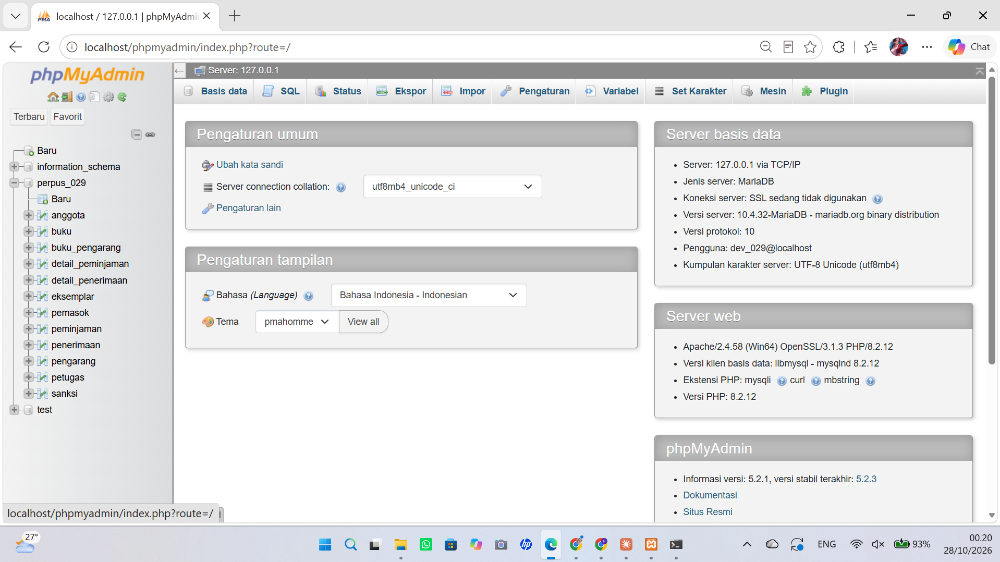

*Keterangan:* Designer menampilkan 12 tabel beserta garis relasi FK, termasuk tabel asosiatif `buku_pengarang` (relasi banyak-ke-banyak antara `buku` dan `pengarang`) dan FK komposit dari `sanksi` ke `detail_peminjaman`. Halaman utama phpMyAdmin menegaskan pengguna aktif `dev_029@localhost`, server MariaDB 10.4.32.

---

## 4. Jawaban Titik Analisis

### Titik Analisis 1
> _(Salin pertanyaan Titik Analisis 1 dari buku lalu isi jawabannya di sini.)_
>
> *Bahan jawaban dari bukti percobaan:* kolom kunci tamu dan kolom induknya bertipe sama persis, misalnya `id_petugas SMALLINT(6)` pada `petugas`, `peminjaman`, `detail_peminjaman`, dan `sanksi`; sedangkan `id_anggota INT(11)` pada `anggota` dan `peminjaman`.

### Titik Analisis 2
**Pertanyaan:** Kode galat 1452, 4025, dan 1062 muncul pada tiga percobaan. Petakan setiap kode ke aturan bisnis (AB-xx) yang dilindunginya. Aturan bisnis mana yang **belum** dapat dijaga oleh constraint?

**Jawaban – pemetaan kode galat:**

| Kode | Arti | Contoh pada percobaan | Aturan bisnis yang dilindungi | Kode AB |
|:---:|---|---|---|:---:|
| **1452** | Pelanggaran `FOREIGN KEY` pada baris anak | Peminjaman dengan `id_petugas = 99` ditolak oleh `fk_peminjaman_petugas` | Setiap nota peminjaman wajib dicatat oleh petugas yang terdaftar | AB-xx |
| **4025** | Pelanggaran `CHECK` | Jatuh tempo mendahului tanggal pinjam; pengembalian parsial; denda tanpa nominal; jumlah terima 0; identitas anggota tidak sesuai jenis | Kewajaran nilai dan konsistensi antar-kolom dalam satu baris | AB-xx |
| **1062** | Pelanggaran `UNIQUE` | NIM `25430029` kembar ditolak oleh `uq_anggota_nim` | Satu NIM hanya dimiliki satu anggota | AB-xx |

*(Kolom "Kode AB" diisi sesuai dokumen kebutuhan data masing-masing.)*

**Jawaban – aturan yang belum dapat dijaga constraint.** `CHECK` hanya dapat melihat **satu baris pada satu tabel**. Aturan yang melibatkan banyak baris atau banyak tabel tidak terjaga oleh DDL yang ada, misalnya:

1. **Status anggota saat meminjam.** Anggota berstatus `Ditangguhkan` atau `Nonaktif` seharusnya tidak boleh meminjam. `status_anggota` ada di tabel `anggota`, sedangkan peminjaman tersimpan di `peminjaman`, sehingga `CHECK` pada `peminjaman` tidak bisa membacanya.
2. **Keselarasan status eksemplar.** Eksemplar yang sedang dipinjam semestinya berstatus `Dipinjam` dan kembali menjadi `Tersedia` setelah dikembalikan. Pembaruan `eksemplar.status_eksemplar` dan `detail_peminjaman` harus dilakukan bersama, dan constraint tidak memaksanya.
3. **Tanggal kembali tidak mendahului tanggal pinjam.** Tanggal pinjam ada di `peminjaman`, tanggal kembali di `detail_peminjaman` (lintas tabel).
4. **Batas jumlah buku per anggota dalam satu waktu.** Aturan ini membutuhkan penghitungan banyak baris (mirip batas "jumlah baris per transaksi"), yang tidak dapat dijaga `CHECK`.
5. **Eksemplar tidak boleh dipinjam ganda pada periode yang sama.** Perlu memeriksa baris lain yang masih berstatus berjalan.

Aturan-aturan tersebut ditandai untuk diselesaikan pada **Modul 14** (transaksi dan pemicu), sesuai catatan modul.

### Titik Analisis 3
**Pertanyaan:** Mengapa `DROP TABLE IF EXISTS` harus dimulai dari `detail_*` (tabel anak), bukan dari tabel induk seperti `petugas`? Apa pesan galat jika urutannya dibalik?

**Jawaban:**

- Tabel anak memiliki `FOREIGN KEY` yang merujuk tabel induk. Selama tabel anak masih ada, tabel induk **dilindungi** oleh FK tersebut. Menghapus tabel induk lebih dulu berarti membuang tabel yang masih dirujuk, sehingga server menolaknya demi menjaga integritas referensial.
- Karena itu urutan penghapusan harus **kebalikan dari urutan pembuatan**: anak (`detail_peminjaman`, `detail_penerimaan`, `sanksi`, ...) dihapus lebih dahulu, baru induk (`peminjaman`, `petugas`, `anggota`, ...).
- Jika urutan dibalik, server mengembalikan galat penolakan FK berpesan *"Cannot delete or update a parent row: a foreign key constraint fails"* (galat 1451, atau 1217 pada sebagian versi). Perilaku yang sama terbukti pada percobaan `DELETE` (Gambar 13), yaitu galat 1451 ketika induk dihapus selagi anak masih ada. Urutan terbalik pada `DROP TABLE` tidak diuji dalam praktikum ini.
- Bukti bahwa urutan pada skrip sudah benar: skrip dapat dijalankan ulang tanpa galat (Gambar 3).

---

## 5. Hasil Latihan dan Modifikasi

### 5.1 Modifikasi struktur (D.4 langkah 6)

Modul meminta penambahan kolom tanggal kedaluwarsa pada tabel barang. Pada skema perpustakaan, penyesuaiannya adalah kolom `edisi_buku` pada tabel `buku`. Kolom ditambahkan dengan `ADD COLUMN ... AFTER`, diperiksa dengan `DESCRIBE`, kemudian dibatalkan dengan `DROP COLUMN` (lihat Gambar 15 dan 16).

### 5.2 Latihan E.1 – CHECK nilai tidak negatif, dibuktikan dengan perintah yang ditolak

Pada skema perpustakaan tidak ada kolom stok seperti pada Kopma; padanan terdekat untuk aturan "nilai tidak boleh negatif" adalah `nominal_sanksi` yang sudah dijaga oleh `ck_sanksi_nominal`. Pembuktiannya:

```sql
INSERT INTO sanksi (nomor_sanksi, jenis_sanksi, nominal_sanksi, tanggal_sanksi,
                    id_peminjaman, id_eksemplar, id_petugas)
VALUES ('SK-2610-004', 'Denda', -5000, '2026-10-15', 1, 1, 1);
-- hasil yang diharapkan: ERROR 4025 (23000): CONSTRAINT `ck_sanksi_nominal` failed
```

> **Bukti:** _(sisipkan tangkapan layar hasil perintah di atas: `gambar/p05_16_latihan_e1.png`)_

### 5.3 Latihan E.2 – `ON DELETE SET NULL` pada relasi anggota

Perubahan `fk_peminjaman_anggota` menjadi `ON DELETE SET NULL` mengharuskan kolom `id_anggota` pada `peminjaman` boleh `NULL`, padahal saat ini `NOT NULL`:

```sql
ALTER TABLE peminjaman DROP FOREIGN KEY fk_peminjaman_anggota;
ALTER TABLE peminjaman MODIFY id_anggota INT(11) NULL;
ALTER TABLE peminjaman ADD CONSTRAINT fk_peminjaman_anggota
  FOREIGN KEY (id_anggota) REFERENCES anggota (id_anggota) ON DELETE SET NULL;
```

**Diskusi.** Pada perpustakaan, setiap peminjaman wajib diketahui peminjamnya, sehingga mengizinkan `NULL` akan menghasilkan catatan peminjaman yatim (tidak ada yang bertanggung jawab atas buku yang dipinjam). Di sisi lain, penghapusan data pribadi anggota dapat diminta berdasarkan UU Pelindungan Data Pribadi. Jalan tengah yang lebih aman adalah **tidak menghapus baris anggota**, melainkan menonaktifkannya (`status_anggota = 'Nonaktif'`) dan menganonimkan kolom data pribadi (`no_hp_anggota`, `alamat_anggota`), sehingga riwayat peminjaman tetap utuh. Dengan demikian, `ON DELETE SET NULL` **kurang sesuai** untuk entitas ini, dan perilaku bawaan (`RESTRICT`, terbukti pada galat 1451) lebih tepat.

> **Catatan:** Latihan E.2 dijawab sebagai analisis; perintah di atas tidak dijalankan pada basis data akhir agar struktur proyek tidak berubah.

---

## 6. Tugas Mandiri: Milestone Proyek 05

### 6.1 Cakupan

| Persyaratan milestone | Status | Bukti |
|---|:---:|---|
| `p05_ddl_25430029.sql` untuk seluruh tabel proyek, dapat dijalankan ulang dari basis data kosong | ✅ | Gambar 2, 3 |
| Setiap tabel memiliki kunci primer | ✅ | Gambar 8a, 8b (12 PK) |
| Setiap relasi ERD menjadi kunci tamu | ✅ | Gambar 8a, 8b, 17 |
| Aturan bisnis yang dapat dijaga struktur menjadi constraint dan diberi komentar AB-xx | ✅ | Bagian 3.4, 3.7 |
| Aturan batas P+2: satu baris → `CHECK`; jumlah baris per transaksi → dicatat tidak dapat dijaga `CHECK` | ✅ | Bagian 4 (Titik Analisis 2) |
| ERD fisik `p05_erd_fisik_25430029.png` memenuhi standar kelengkapan | ✅ | Gambar 19 |
| Tabel pemetaan tipe data dan hasil perbandingan Designer dengan ERD | ✅ | Bagian 2.1 dan 6.3 |

### 6.2 Pengelompokan tabel proyek

| Jenis | Tabel | Satu baris mewakili |
|---|---|---|
| Master | `petugas` | satu petugas perpustakaan |
| Master | `anggota` | satu anggota (mahasiswa atau dosen) |
| Master | `buku` | satu judul buku |
| Master | `eksemplar` | satu salinan fisik buku |
| Master | `pengarang` | satu pengarang |
| Master | `pemasok` | satu pemasok buku |
| Asosiatif | `buku_pengarang` | satu pasangan buku–pengarang |
| Kepala transaksi | `peminjaman` | satu nota peminjaman |
| Detail transaksi | `detail_peminjaman` | satu eksemplar dalam satu nota peminjaman |
| Kepala transaksi | `penerimaan` | satu nota penerimaan buku dari pemasok |
| Detail transaksi | `detail_penerimaan` | satu judul buku dalam satu nota penerimaan |
| Transaksi turunan | `sanksi` | satu sanksi atas satu eksemplar pada satu peminjaman |

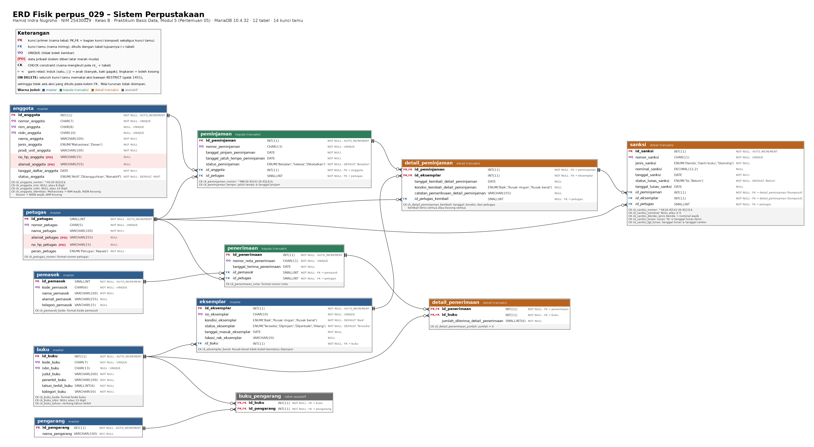

### 6.3 Perbandingan Designer dengan ERD

| Aspek | Hasil pengamatan |
|---|---|
| Relasi FK | Seluruh FK pada DDL tergambar sebagai garis relasi di Designer, termasuk FK komposit `sanksi → detail_peminjaman` |
| Tipe data dan ENUM | Tipe, panjang, dan nilai `ENUM` tampil di Designer sehingga dapat dicocokkan kolom demi kolom |
| Constraint `CHECK` | **Tidak** ditampilkan oleh Designer; dokumentasinya harus dilengkapi pada ERD fisik dan `SHOW CREATE TABLE` |
| Aksi `ON DELETE` | Tidak tertulis pada garis relasi; perilaku bawaan `RESTRICT` dibuktikan lewat galat 1451 |
| Tata letak | Posisi tabel pada Designer belum disimpan sebagai halaman bernama (judul masih "Belum ada nama") |

---

## 7. Pembahasan dan Kendala

**Pembahasan**

1. **Constraint menjadi penjaga terakhir.** Seluruh sepuluh pelanggaran pada uji negatif ditolak langsung oleh server, tanpa bergantung pada aplikasi. Hal ini membuktikan aturan bisnis sudah "dijaga oleh server".
2. **Tiga kelompok kode galat.** 1452 dan 1451 berasal dari FK (anak tanpa induk / induk yang masih dipakai), 1062 dari `UNIQUE`, dan 4025 dari `CHECK`. Membaca kode galat membantu menelusuri aturan mana yang dilanggar.
3. **`CHECK` multi-kolom sangat bermanfaat.** `ck_detail_peminjaman_kembali` memaksa tiga kolom pengembalian terisi serentak atau kosong serentak, sedangkan `ck_anggota_identitas` mengikat jenis anggota dengan NIM/NIDN. Tanpa constraint ini, data setengah jadi mudah masuk.
4. **Uji positif sama pentingnya.** Perintah sah yang diterima (Gambar 14) menunjukkan bahwa constraint tidak terlalu ketat, dan `DEFAULT` bekerja sesuai rancangan.
5. **Perilaku hapus bawaan (`RESTRICT`).** Nota peminjaman dan petugas yang sudah dipakai tidak dapat dihapus sehingga jejak sejarah transaksi tetap terjaga.
6. **Desain tipe data.** Kode identitas (`nim`, `nomor_*`) memakai `CHAR` berpanjang tetap, nominal uang memakai `DECIMAL(12,2)`, dan kolom FK memakai tipe yang identik dengan kolom induknya sehingga menghindari ERROR 1005 errno 150.

**Kendala dan catatan teknis**

| Kendala | Penanganan |
|---|---|
| Nama basis data dan akun berbeda dari contoh modul (`perpus_029`/`dev_029` dibanding `kopma_<3d>`/`mhs_<3d>`) | Seluruh langkah dan latihan diterjemahkan ke skema perpustakaan |
| Pola nama `pk_` tidak dapat dipakai untuk primary key | Dicatat bahwa MariaDB selalu menamainya `PRIMARY` |
| Daftar 58 constraint terlalu panjang untuk satu layar | Dibagi menjadi dua tangkapan layar (atas dan bawah) |
| Beberapa aturan bisnis melibatkan lebih dari satu tabel | Tidak dapat dijaga `CHECK`; dicatat untuk Modul 14 |
| Pengujian hapus membutuhkan data anak yang sudah terisi | Uji hapus dijalankan setelah uji positif |

---

## 8. Kesimpulan

1. Skema 3NF perpustakaan berhasil diterjemahkan menjadi **12 tabel** dengan tipe data yang sesuai dan total **58 constraint** (PK, FK, UNIQUE, CHECK) yang bernama konsisten.
2. Skrip DDL dapat dijalankan ulang tanpa galat sehingga siap dipakai pada basis data kosong maupun yang sudah terisi.
3. Constraint terbukti menolak data yang melanggar aturan: **10 dari 10** skenario negatif ditolak dengan kode yang sesuai (1452, 1062, 4025, dan 1451), sementara data yang sah diterima.
4. `ALTER TABLE` dan `DROP COLUMN` dapat mengubah struktur dengan aman, dan kolom opsional (`NULL`) tidak mengganggu data lama.
5. Tidak semua aturan bisnis dapat dijaga struktur: aturan lintas baris atau lintas tabel membutuhkan mekanisme transaksi pada pertemuan berikutnya.

---

## 9. Pernyataan Penggunaan AI

Saya menggunakan asisten AI (Claude, Anthropic) untuk membantu **menyusun kerangka dan merapikan narasi laporan** berdasarkan tangkapan layar dan buku praktikum yang saya sediakan. Seluruh eksekusi perintah SQL, pengambilan tangkapan layar, dan pengujian dilakukan sendiri pada komputer saya. Isi laporan telah saya baca, periksa kesesuaiannya dengan hasil percobaan, dan saya bertanggung jawab penuh atas kebenarannya.

---

## 10. Bukti Git

| Item | Isi |
|---|---|
| Repositori | `https://github.com/viaindra40-commits/basisdata-25430029` |
| Berkas laporan | `laporan/p05_laporan_25430029.md` |
| Berkas SQL | `p05_ddl_25430029.sql` |
| ERD fisik | `erd/p05_erd_fisik_25430029.png` (sumber: `erd/p05_erd_fisik_25430029.dot`) |
| Pesan commit | `p05: ddl perpus` |
| Hash commit | `83049b5` |

---

## Checklist

**Checklist khusus Pertemuan 5**

- [x] Skrip `p05_ddl_25430029.sql` dapat dijalankan ulang dari basis data kosong
- [x] ERD fisik `p05_erd_fisik_25430029.png` terlampir
- [x] `SHOW CREATE TABLE` tabel utama (`peminjaman`, `detail_peminjaman`, `anggota`, `sanksi`)
- [x] Galat saat constraint dilanggar (FK, UNIQUE, CHECK)
- [x] Analisis alasan pemilihan tipe data dan constraint
- [x] Kaitan constraint dengan aturan bisnis (AB-xx)

**Checklist umum**

- [x] Identitas (nama, NIM, kelas, tanggal) terisi
- [x] Urutan bagian laporan sesuai struktur baku
- [x] Setiap tangkapan layar disertai keterangan
- [ ] Jawaban Titik Analisis 1 terisi
- [ ] Bukti tangkapan layar Latihan E.1 terlampir
- [ ] Tautan repositori dan hash commit terisi
- [ ] Laporan sudah di-*push* sebelum batas waktu


